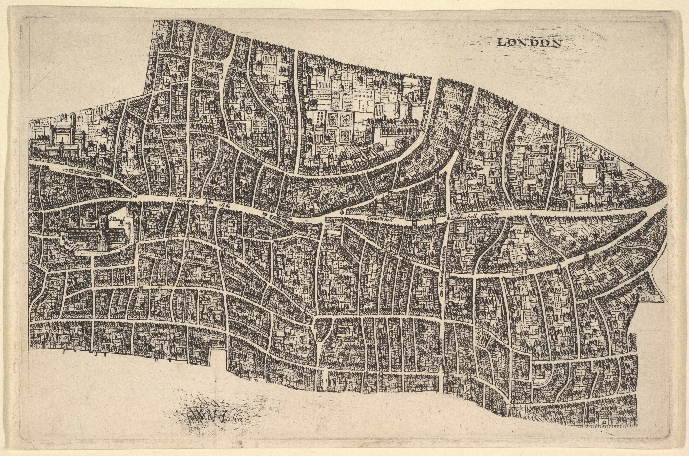
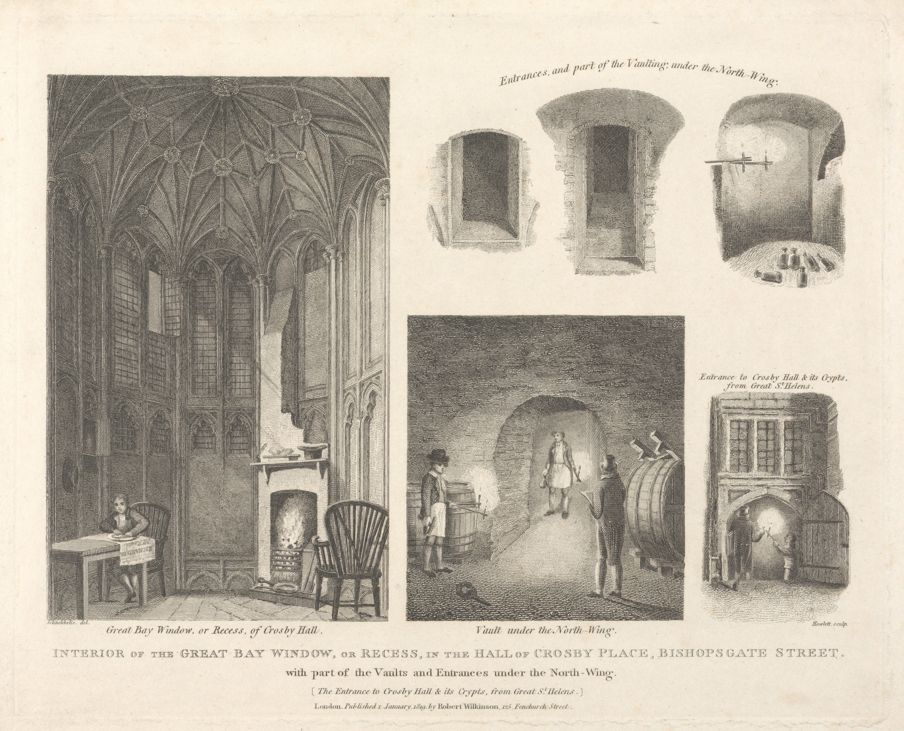
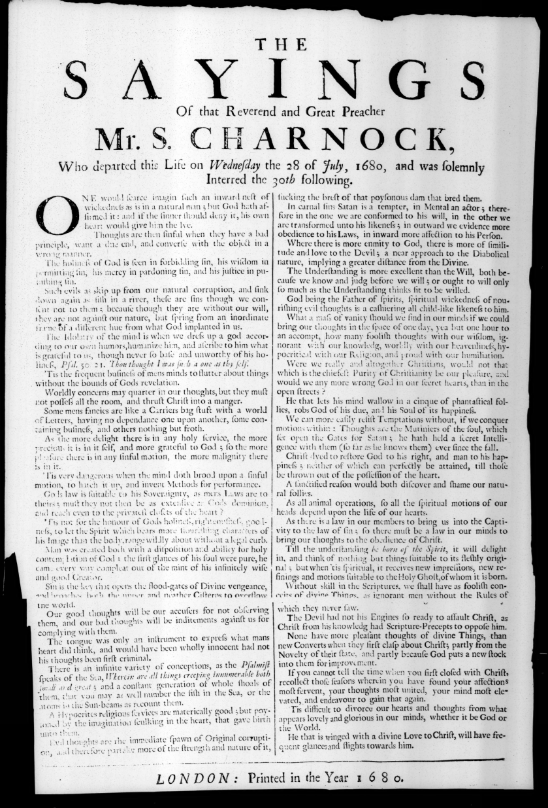

# СТИВЕН ЧАРНОК: КРОМВЕЛЬ, ЛОНДОНСКИЙ ПОЖАР И КНИГА, ВЫШЕДШАЯ ПОСЛЕ СМЕРТИ

*Документальная история английского проповедника, чья жизнь прошла между гражданской войной, Ирландией Кромвелей, Великим пожаром и Реставрацией. 1628–1680.*

## Коротко

- В **1642 году**, накануне гражданской войны, Чарнок поступил в Кембридж; его наставник Уильям Санкрофт впоследствии стал архиепископом Кентерберийским.
- В **1650-е годы** он служил в Оксфорде и затем в Дублине при Генри Кромвеле; предполагаемое назначение капелланом полка Гаррисона требует осторожной атрибуции.
- После **Реставрации 1660 года** он долго не имел постоянной пасторской должности; **Великий пожар 1666 года** лишил его библиотеки.
- В **1675 году** он стал пастором общины, собиравшейся в Кросби-холле, вместе с Томасом Уотсоном.
- После смерти Чарнока в **1680 году** друзья подготовили его рукописи к печати; главный том о бытии и свойствах Бога вышел в **1682 году**.

## Пролог. Город, который исчез в пламени

В сентябре 1666 года Лондон горел. Огромные районы старого города были уничтожены, исчезали дома, мастерские, библиотеки и церкви. Художник и гравёр Венцеслав Холлар представил город до пожара и после него в одной исторической панораме. Это не современный рисунок, а документ художественной культуры XVII века. [1]

**Документальная иллюстрация I.** Венцеслав Холлар, «Лондон до и после Великого пожара», 1666 год, Metropolitan Museum of Art, 17.50.100/.101. Public Domain. [Оригинал гравюры](https://www.metmuseum.org/art/collection/search/360649).

Среди тех, кто понёс потери, был проповедник Стивен Чарнок: во время пожара погибла его библиотека. Ему было около тридцати восьми лет. За плечами были университеты, служение среди потрясений Английской революции и годы в Ирландии при Генри Кромвеле. Впереди оставалась часть жизни, а затем — появление книги, благодаря которой его имя прославилось. [2]

Но мы не знаем, где Чарнок находился в конкретную минуту пожара, что он пытался вынести из здания и какие именно рукописи исчезли. Реконструкция таких сцен без документов была бы вымыслом. Реальный факт утраты библиотеки сам по себе достаточно драматичен.

У этой истории есть ещё одна необычная особенность. Уже после смерти Чарнока его друзья и издатели Ричард Адамс и Эдуард Вил признались в предисловии к книге 1680 года: читатели просили рассказать о жизни проповедника подробнее, но сами издатели считали неловким предавать широкой огласке частную жизнь человека, который при жизни предпочитал уединение. Поэтому даже ближайшие современники оставили биографу удивительно мало подробностей. Эта сдержанность источников — не недостаток будущего рассказа, а часть самой истории Чарнока. [11]

## 1. Лондон, 1628: сын юриста на пороге революции

Чарнок родился в 1628 году в лондонском приходе Святой Катарины Кри. Его отец, Ричард, занимался юридической практикой. Это позволяет поместить будущего богослова в реальную городскую среду, но не даёт права выдумывать облик семейного дома, семейные разговоры и личные воспоминания детства. [2, 3]

Религиозная жизнь Англии тогда всё сильнее переплеталась с конфликтами о церковной власти, положении епископов, роли парламента и монарха. К моменту поступления Чарнока в университет противостояние перешло в гражданскую войну.

## 2. Кембридж военного времени

30 мая 1642 года Чарнок поступил в Эммануил-колледж Кембриджа. Одним из его наставников был Уильям Санкрофт, будущий архиепископ Кентерберийский. В этом заключается примечательный контраст двух судеб: ученик впоследствии стал нонконформистским проповедником, а учитель — главой государственной Англиканской церкви. [3]

Эта история интересна сама по себе, но она не доказывает, что наставник и ученик лично спорили на занятиях о будущем церковном устройстве. В 1646 году Чарнок получил степень бакалавра, в 1649-м — магистра. Ранние жизнеописания связывают его начало проповеднического служения с Саутуарком, на южном берегу Темзы. [2]

В собственном предисловии 1680 года Адамс и Вил вспоминали, что после университетской учёбы Чарнок некоторое время жил в частном доме, а затем начал проповедовать в Саутуарке. Такие слова важны не потому, что позволяют угадать домашний распорядок, — его мы не знаем, — а потому, что устанавливают цепочку занятий до оксфордского периода. При этом издатели передают не официальный послужной список, а память людей из его круга. [11]

## 3. Возможная служба в армии Гаррисона

В мае 1649 года Чарнок, по современной научной биографии, получил поручение служить капелланом в кавалерийском полку Томаса Гаррисона. Специальное исследование армейских капелланов, однако, помечает идентификацию имени Charnuke в соответствующих документах как предположительную. [3, 5]

Следовательно, это сильная исследовательская линия, но не основание придумывать сцены сражений, армейские походы, разговоры Чарнока с полковником или участие в казни короля. Реальный интерес — в положении молодого проповедника в годы политической катастрофы.

## 4. Оксфорд: университет в эпоху Протектората

В 1650 году Чарнок стал членом академического сообщества Нью-колледжа Оксфорда, в 1652-м получил признание своей магистерской степени, а в 1654 году служил университетским проктором — должностным лицом, связанным с порядком и дисциплиной. [2, 3]

Оливер Кромвель был канцлером университета, а Джон Оуэн — вице-канцлером. Это было время перемены преподавателей, политических присяг и университетской власти. Чарнок не просто читал книги, не замечая истории: его академическая жизнь проходила внутри институционального переворота. Но сама по себе общая университетская среда ещё не доказывает личной дружбы с Оуэном.

## 5. Ирландия Генри Кромвеля: проповедь при власти

Один из самых содержательных периодов жизни Чарнока связан с Дублином. Примерно с 1655 года он служил капелланом в окружении Генри Кромвеля, сына Оливера, и выступал как проповедник в ирландской столице. Ранние биографии называют церковь Святого Вербурга и собор Христа. [2, 3]

Сохранилась редкая административная подробность: историческое исследование армейских капелланов приводит запись о квартальной выплате Чарноку 50 фунтов и указывает на годовой оклад порядка 200 фунтов в 1656 году. Эта сумма показывает официальный характер его положения, но переводить её одной формулой в современные деньги было бы грубым упрощением. [5]

Об этом эпизоде нельзя писать только восторженными словами. Ирландия середины XVII века пережила военное завоевание, жестокость, перемену земельных отношений и сложную религиозную политику. Чарнок служил внутри административной структуры эпохи Кромвелей, а не в историческом вакууме. Вместе с тем приписывать ему личную ответственность за конкретные насильственные решения, не располагая прямыми свидетельствами, было бы недобросовестно.

Его ранние биографы упоминали уважение к проповеднику даже среди несогласных с ним людей. Это свидетельство репутации, но не количественный отчёт о размерах аудитории и не доказательство согласия всего Дублина.

## 6. Возвращение короля и «Великое изгнание», 1660–1662

Реставрация монархии в 1660 году изменила расстановку власти. Карл II вернулся на престол, а люди, имевшие общественное и религиозное влияние в годы республики, оказались в новых условиях. Для Чарнока завершился ирландский период, и он вернулся в Англию без стабильного постоянного пасторского места. [2]

Принятый в 1662 году Акт о единообразии утвердил определённый молитвенно-богослужебный порядок и условия согласия духовенства с ним. Отказ означал потерю места или возможность продолжать официальное служение. С событиями, известными как Великое изгнание, историки связывают около двух тысяч служителей; при этом подсчёт зависит от определения категории отстранённых, покинувших места и лишившихся разрешения. [6, 7]

Но нельзя писать, будто Чарнока лично изгнали из конкретного прихода именно 24 августа 1662 года. Такого эпизода проверенные биографические сведения не подтверждают. История значительна и без вымысла: проповедник, которого знали в университетских и административных кругах, на долгие годы остался без постоянной признанной кафедры.

## 7. Годы учёбы без постоянной кафедры и пожар

Формула «пятнадцать лет без служения» не совсем верна. Чарнок примерно пятнадцать лет не имел постоянного пасторского поста, но продолжал изучать богословие и проповедовать при отдельных возможностях. Биографы упоминают поездки на континент, хотя их точную хронологию пока нельзя восстановить по независимым документам. [2]

В 1666 году лондонский пожар уничтожил его библиотеку. Поздние биографы передают слова редакторов Адамса и Вила, которые называли библиотеку рабочим пространством Чарнока и подчёркивали тщательный отбор книг. Но сохранившегося полного каталога мы не имеем. Нельзя приписывать огню уничтожение всех рукописей и проповедей без проверки каждого конкретного свидетельства. [8]

Есть деталь, способная сделать Чарнока ощутимее для современного читателя, чем любая выдуманная сцена у письменного стола. По словам Адамса и Вила, он записывал размышления не только в часы учёбы, но и во время прогулок по улицам, чтобы мысль не пропадала впустую. Издатели называли его библиотеку мастерской, где он трудился всю неделю, а плоды этого труда становились заметны на воскресной проповеди. Они подчёркивали: книг было не обязательно очень много, зато их подбирали внимательно. Это свидетельство 1680 года, а не поздняя психологическая догадка. [11]

В нём слышен и голос исторической эпохи. Чарнок ещё не работал с напечатанными массовыми тиражами собственных трудов; его обычный рабочий материал составляли книги, черновики и записи для кафедры. Когда именно погиб каждый из этих предметов, остаётся неизвестным. Поэтому рассказ о пожаре должен опираться на подлинные планы и панорамы Лондона, не превращая их в изображение личной комнаты Чарнока.

**Историческая иллюстрация V.** Венцеслав Холлар, *London before the Great Fire*, 1666–1677, офорт, второй вариант оттиска; Metropolitan Museum of Art, инв. **56.581.8**, Public Domain. Показан план лондонского Сити **до пожара 1666 года**, хотя сам оттиск датируется 1666–1677 годами. [Музейная карточка](https://www.metmuseum.org/art/collection/search/361738).

## 8. Кросби-холл: древнее здание и новая община

В 1675 году Чарнок стал пастором лондонской общины вместе с Томасом Уотсоном. Собрания проходили в Кросби-холле, зале старинного здания на Бишопсгейт-стрит. Его история началась ещё в XV веке; оно было связано с лондонским купечеством и с Ричардом III. Это не построенная специально для пуритан церковь, а здание, которому придали новое религиозное назначение. [2, 8]

Здесь есть редкая возможность поставить рядом историю человека и историю места. Старинные стены, расписное остекление и деревянное перекрытие дают зрительное представление о среде. Но архитектура менялась; часть большого зала впоследствии перенесли из Бишопсгейта в Челси. Изображение XIX века нельзя подписывать «так выглядела община Чарнока в 1675 году».

**Историческая иллюстрация.** Бартоломью Хоулетт, *Interior of the Great Bay Window, or Recess in the Hall of Crosby Place*, **1819 год**. Yale Center for British Art, инв. **B1977.14.15862**; цифровое изображение CC0. [Коллекционная карточка](https://collections.britishart.yale.edu/catalog/tms:32743) · [официальный IIIF-манифест](https://manifests.collections.yale.edu/ycba/obj/32743). Показано позднейшее состояние здания, а **не зафиксированный интерьер собрания 1675 года**.

В предисловии 1680 года Адамс и Вил называли Чарнока верным последователем вероучения Англиканской церкви, изложенного в её статьях веры. Это свидетельство не отменяет его нонконформистского служения после Реставрации: несогласие с установленным церковным порядком не означало отрицания всех доктринальных положений английской Реформации. Такую тонкость необходимо сохранить, вместо того чтобы без оговорок переносить сегодняшние конфессиональные границы на XVII век. [11]

Связь с Уотсоном помогает раскрыть Чарнока прежде всего как проповедника конкретной пресвитерианской общины, а не как одинокого автора отвлечённых трактатов.

Община имела дело с проповедью, которую нужно было слушать, обсуждать и применять, а не с будущей знаменитой библиотечной книгой. И в этом состоит важный исторический сдвиг перспективы: для большинства людей в Кросби-холле Чарнок был **живым пастором**, а не именем на титульном листе. Редакторы после его смерти вспоминали даже полемику о его стиле: некоторым слушателям проповеди казались слишком сложными, тогда как другие ценили их глубину и связность. Эти оценки не дают численности сторон, но позволяют представить реальную разницу восприятия одной и той же кафедры. [11]

## 9. За проповедями — человек: зрение, память, характер

У самого Чарнока не сохранилось фотографий — фотография появится лишь в XIX столетии. Исторический портрет, к которому стоит обращаться, — **гравюра Роберта Уайта, опубликованная в 1684 году**, через четыре года после смерти проповедника. [Национальная портретная галерея, NPG D29678](https://www.npg.org.uk/collections/search/portrait/mw137411/Stephen-Charnock). Её нельзя выдавать за прижизненный фотопортрет, а музейную цифровую копию нужно использовать с учётом условий коллекции.

Большой интерес представляет свидетельство о трудностях последних лет Чарнока. Биографы сообщают, что из-за ухудшения памяти он стал читать подготовленные проповеди, а слабое зрение вынуждало пользоваться увеличительным стеклом. Это меняло манеру выступления: слушатели, прежде ценившие устную силу его проповеди, не всегда принимали столь насыщенное и внимательное чтение. [2, 8]

Сохранился и более земной штрих к характеру. Адамс и Вил описывали Чарнока как сдержанного среди незнакомых людей, но приветливого и разговорчивого в кругу близких знакомых. По их свидетельству, он сознательно ограничивал посещения, предпочитая время за книгами и беседы, из которых мог узнать что-то существенное. Их характеристика проникнута уважением к умершему другу, но именно поэтому её следует читать как **именованное свидетельство**, а не как беспристрастную психологическую экспертизу. [11]

В том же предисловии упоминаются познания Чарнока в медицине: издатели считали, что он мог бы заниматься врачебной практикой, однако посвятил основные усилия проповеди. **Это не свидетельство, что он действительно лечил больных в определённой больнице или имел медицинский диплом.** [11]

Нельзя превращать этот факт в несуществующий диагноз. Но он помогает понять характер наследия Чарнока: за фундаментальными богословскими сочинениями стоял человек, чей труд не становился проще с годами и физическими ограничениями.

По изложению Джеймса Маккоша, основанному на свидетельствах современников, последние завершённые рассуждения Чарнока касались **Божьего долготерпения**; к дальнейшим темам милости и благодати он перейти уже не успел. Это важный драматический эпизод, который следует приписывать источнику («по словам Джона Джонсона в позднейшем пересказе»), а не выдавать за дату из дневника самого Чарнока. [8]

## 10. Июль 1680 года: смерть, погребение и разночтение дат

Чарнок умер в июле 1680 года в возрасте около пятидесяти двух лет. Биографическая традиция обычно называет **27 июля**, но печатное издание 1680 года *The Sayings of That Reverend and Great Preacher Mr. S. Charnock* относит смерть к **среде 28 июля**. Эти данные расходятся; в основном тексте безопаснее указывать месяц и год, а оба свидетельства назвать в примечании. [2, 9]

**Историческая иллюстрация — источник разночтения.** *The Sayings of That Reverend and Great Preacher Mr. S. Charnock*, Лондон, **1680 год**. На самом листе напечатана дата смерти — среда, 28 июля, и погребения — 30 июля. Это прямое раннее печатное свидетельство, но оно не устраняет автоматически расхождение с датой 27 июля в поздней биографической традиции. [Цифровой оригинал — Internet Archive / Wikimedia Commons](https://commons.wikimedia.org/wiki/File:The_sayings_of_that_reverend..._1680_(IA_bim_early-english-books-1641-1700_the-sayings-of-that-reve_charnock-stephen_1680).pdf). Изображение воспроизводит исторический лист без дорисовки и изменения текста.

Согласно *Dictionary of National Biography*, смерть наступила в доме Ричарда Тиммса, стекольщика, в Уайтчепеле. Тело перенесли в Кросби-холл, затем к церкви Святого Михаила на Корнхилле. Погребение состоялось **30 июля 1680 года**. [2]

Надгробную проповедь произнёс Джон Джонсон, друг Чарнока ещё с университетских лет. В 1680 году она вышла под названием *The Shining Forth of the Righteous* («Сияние праведных»). Библейский текст — **Мф. 13:43**. Важно, что опубликованная проповедь частично относилась также к памяти другого человека: её содержание нельзя целиком принимать за самостоятельную биографию Чарнока. [9]

Сама надгробная проповедь была напечатана в 1680 году; её библиографическая запись сохранилась в английских каталогах под названием *The Shining Forth of the Righteous*. [Каталог издания](https://www.grubstreetproject.net/people/70902/works/).

## 11. Редакторы, которые спасли книги для будущего

Главные сочинения Чарнока стали известны читателям преимущественно посмертно. Огромную работу выполнили его друзья **Ричард Адамс и Эдуард Вил**: они приводили в порядок рукописи, переписывали и подготавливали их к печати. [2, 8]

В 1680 году вышел труд о Божьем промысле. В **1682 году** увидело свет первое издание *Several Discourses upon the Existence and Attributes of God* («Рассуждения о бытии и свойствах Бога»). Каталоги сохраняют данные об издании: Лондон, D. Newman, T. Cockerill и другие книгопродавцы; 827 страниц основного текста, помимо вводных и дополнительных листов. Следующие издания появились уже в конце XVII века. [10]

**И всё же при жизни Чарнок не был совсем не печатавшимся автором.** Сохранилась его проповедь о греховности человеческих мыслей и борьбе с ними (*The Sinfulness and Cure of Thoughts*), вошедшая в цикл *Morning Exercises at Cripplegate*. Поздний биограф Маккош называет её единственной публикацией, появившейся при жизни проповедника. Этот факт особенно выразителен на фоне будущего многотомного наследия; точную дату первоначального печатного выпуска следует отличать от дат позднейших переизданий, по которым сегодня чаще доступны сканы. [8, 12]

> «Пусть те, кто слышал его, говорят о нём; а если они промолчат, за него заговорят его труды».
> — Ричард Адамс и Эдуард Вил, предисловие 1680 года; перевод редакции [11]

Ещё важнее собственная оговорка Адамса и Вила в предисловии 1680 года. Они объяснили, что сначала напечатали трактат о Божьем промысле **потому, что его рукопись удалось подготовить раньше других**, а не потому, что это было единственное или непременно лучшее сочинение Чарнока. Они также предупреждали читателей об опасности неточных записей, сделанных слушателями во время проповедей, и говорили, что просматривают авторские экземпляры. Перед нами ранний случай борьбы за текстовую достоверность: посмертные редакторы хотели сохранить не просто имя знаменитого проповедника, а то, что он действительно написал. [11]

Здесь исторический рассказ достигает кульминации. Городской пожар 1666 года уничтожил библиотеку; смерть 1680-го оборвала работу автора. Однако записанные проповеди пережили обе утраты. Книга не могла появиться без труда людей, чьи имена редко стоят на обложках популярных пересказов: редакторов, переписчиков, наборщиков, издателей.

## Эпилог. Труд пережил эпоху

Историю Чарнока не следует превращать ни в легенду о безупречном пуританине, ни в универсальный сборник нравственных наставлений. Его жизнь прошла среди революционных перемен, спорной власти в Ирландии, реставрации монархии, религиозных ограничений и городской катастрофы. Не каждый поворот его судьбы освещён источниками одинаково хорошо.

Английский нонконформистский проповедник не был баптистом; точнее говорить о его пресвитерианских корнях. Его произведения могут высоко ценить христиане разных протестантских традиций, не переписывая его конфессиональную принадлежность.

Первая статья серии рассказывала, как изучение Божьих свойств влияет на веру и повседневную жизнь. Эта — о **человеке, времени и документах**, без которых мы не знали бы так много о его проповедях. Историческая нить ведёт от Кембриджа и Дублина к обгоревшему Лондону, от Кросби-холла к похоронам и от оставленных рукописей к большому тому 1682 года.

Именно так стоит завершить документальный очерк: не искусственной эмоциональной кульминацией, а **подлинной книгой, сохранившейся после смерти автора**.

---

## Источниковый аппарат для финальной сверки

1. **Metropolitan Museum of Art**, Wenceslaus Hollar, *Prospects of London Before and After the Great Fire*, 1666; [объект 360649, Public Domain](https://www.metmuseum.org/art/collection/search/360649).
2. **W. G. Blaikie**, «Charnock, Stephen», *Dictionary of National Biography*, т. 10, 1887; [полный текст с последующим errata](https://en.wikisource.org/wiki/Dictionary_of_National_Biography,_1885-1900/Charnock,_Stephen). Историческая биография XIX века, не первичная запись XVII века.
3. **Richard L. Greaves**, «Charnock, Stephen (1628–1680)», *Oxford Dictionary of National Biography*; [научная статья](https://academic.oup.com/oxford-dictionary-of-national-biography/reference/63486/reference-article-abstract/579804638). Часть текста доступна только подписчикам.
4. **Emmanuel College, Cambridge**, [история колледжа и сведения о Санкрофте](https://apps.emma.cam.ac.uk/college/paintings/).
5. **Parliamentary Army Chaplains 1642–51**, историческое исследование университетского архива Оксфорда; [сведения о Charnock/Charnuke](https://ora.ox.ac.uk/objects/uuid:136e619f-e86b-4184-a247-1bc6c6a81b64). Служба в полку не равна доказанному участию в битвах.
6. **UK Parliament**, [Act of Uniformity 1662](https://www.parliament.uk/about/living-heritage/transformingsociety/private-lives/religion/collections/common-prayer/act-of-uniformity-1662/).
7. **James Walters**, «The Act of Uniformity and the Great Ejection», Cambridge University Press, 2022; [анализ](https://www.cambridge.org/core/books/abs/national-covenant-and-the-solemn-league-and-covenant-16601696/act-of-uniformity-and-the-great-ejection/53D564A744EF64DB8C07D7099A0C5A1C).
8. **James McCosh**, историческое введение к собранию сочинений Чарнока (XIX век), с передачей свидетельств Ричарда Адамса, Эдуарда Вила и Джона Джонсона; [полный текст](https://www.digitalpuritan.net/Digital%20Puritan%20Resources/Charnock,%20Stephen/The%20Complete%20Works%20of%20Stephen%20Charnock%20(vol.1).txt.html). Сохранять атрибуцию собственных слов Маккоша и ранних свидетелей.
9. **John Johnson**, *Eklampsis tōn dikaiōn; or, The Shining Forth of the Righteous* (London, 1680), ESTC R16247; [библиография](https://www.grubstreetproject.net/people/70902/works/). Дату 28 июля сообщает другой ранний источник — печатный лист *The Sayings of That Reverend and Great Preacher Mr. S. Charnock* (1680), [полный одностраничный скан Internet Archive](https://commons.wikimedia.org/wiki/File:The_sayings_of_that_reverend..._1680_(IA_bim_early-english-books-1641-1700_the-sayings-of-that-reve_charnock-stephen_1680).pdf), оригинал которого теперь проверен и включён иллюстрацией выше. Независимая сверка с приходской книгой погребений ещё требуется.
10. **Stephen Charnock**, *Several Discourses upon the Existence and Attributes of God* (1682); [каталог Folger](https://catalog.folger.edu/record/470309), [цифровая карточка British Library / Google Books](https://books.google.com/books?id=W1Retr5Okv0C).

11. **Richard Adams и Edward Veal**, «To the Reader», предисловие к *A Treatise of Divine Providence* (London, 1680), перепечатано в *The Complete Works of Stephen Charnock*, т. I (Edinburgh: James Nichol, 1864), печатные с. 3–5. [Оцифрованный текст, раздел To the Reader](https://www.digitalpuritan.net/Digital%20Puritan%20Resources/Charnock,%20Stephen/The%20Complete%20Works%20of%20Stephen%20Charnock%20(vol.1).txt.html). Первоисточник слов издателей передан в переиздании XIX века, а отдельный современный английский перевод помещён в книге *Divine Providence* (ред. C. B. Whiting, 2022), с. xxv–xxviii.
12. **Stephen Charnock**, «The Sinfulness and Cure of Thoughts» (Быт. 6:5), в *The Morning Exercises at Cripplegate*, позднейшее собрание проповедей, т. II, с. 386 и далее: [печатный текст проповеди](https://www.digitalpuritan.net/Digital%20Puritan%20Resources/Cripplegate/The%20Morning%20Exercises%20at%20Cripplegate%20%28vol.2%29%20-%20Ind%20Works/%5BCG%20v2s19s%5D%20The%20Sinfulness%20and%20Cure%20of%20Thoughts%20%28Stephen%20Charnock%29.pdf). Дата самого скана не равна первоначальному изданию.
