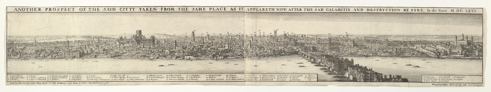

# СТИВЕН ЧАРНОК: КРОМВЕЛЬ, ЛОНДОНСКИЙ ПОЖАР И КНИГА, ВЫШЕДШАЯ ПОСЛЕ СМЕРТИ

*Историко-документальный очерк, редакционный черновик от 16 ноября 2026 года. Не включён в очередь публикации. Это будущая вторая статья о Чарноке, а не уже существующая статья с ID history-02 о Реформации XVI века.*

## Пролог. Город, который исчез в пламени

В сентябре 1666 года Лондон горел. Огромные районы старого города были уничтожены, исчезали дома, мастерские, библиотеки и церкви. Художник и гравёр Венцеслав Холлар представил город до пожара и после него в одной исторической панораме. Это не современный рисунок, а документ художественной культуры XVII века. [1]

**Документальная иллюстрация I.** Венцеслав Холлар, «Лондон до и после Великого пожара», 1666 год, Metropolitan Museum of Art, 17.50.100/.101. Public Domain. [Оригинал гравюры](https://www.metmuseum.org/art/collection/search/360649).

Среди тех, кто понёс потери, был проповедник Стивен Чарнок: во время пожара погибла его библиотека. Ему было около тридцати восьми лет. За плечами были университеты, служение среди потрясений Английской революции и годы в Ирландии при Генри Кромвеле. Впереди оставалась часть жизни, а затем — появление книги, благодаря которой его имя прославилось. [2]

Но мы не знаем, где Чарнок находился в конкретную минуту пожара, что он пытался вынести из здания и какие именно рукописи исчезли. Реконструкция таких сцен без документов была бы вымыслом. Реальный факт утраты библиотеки сам по себе достаточно драматичен.

## 1. Лондон, 1628: сын юриста на пороге революции

Чарнок родился в 1628 году в лондонском приходе Святой Катарины Кри. Его отец, Ричард, занимался юридической практикой. Это позволяет поместить будущего богослова в реальную городскую среду, но не даёт права выдумывать облик семейного дома, семейные разговоры и личные воспоминания детства. [2, 3]

Религиозная жизнь Англии тогда всё сильнее переплеталась с конфликтами о церковной власти, положении епископов, роли парламента и монарха. К моменту поступления Чарнока в университет противостояние перешло в гражданскую войну.

## 2. Кембридж военного времени

30 мая 1642 года Чарнок поступил в Эммануил-колледж Кембриджа. Одним из его наставников был Уильям Санкрофт, будущий архиепископ Кентерберийский. В этом заключается примечательный контраст двух судеб: ученик впоследствии стал нонконформистским проповедником, а учитель — главой государственной Англиканской церкви. [3]

Эта история интересна сама по себе, но она не доказывает, что наставник и ученик лично спорили на занятиях о будущем церковном устройстве. В 1646 году Чарнок получил степень бакалавра, в 1649-м — магистра. Ранние жизнеописания связывают его начало проповеднического служения с Саутуарком, на южном берегу Темзы. [2]

**Иллюстрация II — только с исторической оговоркой.** Дэвид Логган, Эммануил-колледж, 1690 год. Это более поздний вид — часовня была построена уже после студенческих лет Чарнока. [Гравюра](https://commons.wikimedia.org/wiki/File:Emmanuel_College_Chapel,_Cambridge_by_Loggan_1690_-_sanders_6176.jpg).

## 3. Возможная служба в армии Гаррисона

В мае 1649 года Чарнок, по современной научной биографии, получил поручение служить капелланом в кавалерийском полку Томаса Гаррисона. Специальное исследование армейских капелланов, однако, помечает идентификацию имени Charnuke в соответствующих документах как предположительную. [3, 5]

Следовательно, это сильная исследовательская линия, но не основание придумывать сцены сражений, армейские походы, разговоры Чарнока с полковником или участие в казни короля. Реальный интерес — в положении молодого проповедника в годы политической катастрофы.

## 4. Оксфорд: университет в эпоху Протектората

В 1650 году Чарнок стал членом академического сообщества Нью-колледжа Оксфорда, в 1652-м получил признание своей магистерской степени, а в 1654 году служил университетским проктором — должностным лицом, связанным с порядком и дисциплиной. [2, 3]

Оливер Кромвель был канцлером университета, а Джон Оуэн — вице-канцлером. Это было время перемены преподавателей, политических присяг и университетской власти. Чарнок не просто читал книги, не замечая истории: его академическая жизнь проходила внутри институционального переворота. Но сама по себе общая университетская среда ещё не доказывает личной дружбы с Оуэном.

## 5. Ирландия Генри Кромвеля: проповедь при власти

Один из самых содержательных периодов жизни Чарнока связан с Дублином. Примерно с 1655 года он служил капелланом в окружении Генри Кромвеля, сына Оливера, и выступал как проповедник в ирландской столице. Ранние биографии называют церковь Святого Вербурга и собор Христа. [2, 3]

Сохранилась редкая административная подробность: историческое исследование армейских капелланов приводит запись о квартальной выплате Чарноку 50 фунтов и указывает на годовой оклад порядка 200 фунтов в 1656 году. Эта сумма показывает официальный характер его положения, но переводить её одной формулой в современные деньги было бы грубым упрощением. [5]

Об этом эпизоде нельзя писать только восторженными словами. Ирландия середины XVII века пережила военное завоевание, жестокость, перемену земельных отношений и сложную религиозную политику. Чарнок служил внутри административной структуры эпохи Кромвелей, а не в историческом вакууме. Вместе с тем приписывать ему личную ответственность за конкретные насильственные решения, не располагая прямыми свидетельствами, было бы недобросовестно.

Его ранние биографы упоминали уважение к проповеднику даже среди несогласных с ним людей. Это свидетельство репутации, но не количественный отчёт о размерах аудитории и не доказательство согласия всего Дублина.

**Иллюстрация III — исторический предмет, требующий разрешения.** Томас Дайнели, рисунок собора Христа в Дублине, около 1680 года. Он создан после основного служения Чарнока и не может называться точным видом собора 1655 года. [University of Galway](https://ttce.universityofgalway.ie/irelandillustrated/view/image/ii_image_1372844958).

## 6. 1660–1662: возвращение короля и Великий изгнанный клир

Реставрация монархии в 1660 году изменила расстановку власти. Карл II вернулся на престол, а люди, имевшие общественное и религиозное влияние в годы республики, оказались в новых условиях. Для Чарнока завершился ирландский период, и он вернулся в Англию без стабильного постоянного пасторского места. [2]

Принятый в 1662 году Акт о единообразии утвердил определённый молитвенно-богослужебный порядок и условия согласия духовенства с ним. Отказ означал потерю места или возможность продолжать официальное служение. С событиями, известными как Великое изгнание, историки связывают около двух тысяч служителей; при этом подсчёт зависит от определения категории отстранённых, покинувших места и лишившихся разрешения. [6, 7]

Но нельзя писать, будто Чарнока лично изгнали из конкретного прихода именно 24 августа 1662 года. Такого эпизода проверенные биографические сведения не подтверждают. История значительна и без вымысла: проповедник, которого знали в университетских и административных кругах, на долгие годы остался без постоянной признанной кафедры.

**Иллюстрация IV — документ.** Акт о единообразии 1662 года, Парламентский архив Великобритании. Права на музейную цифровую копию нужно проверить до воспроизведения. [Карточка UK Parliament](https://www.parliament.uk/about/living-heritage/transformingsociety/private-lives/religion/collections/common-prayer/act-of-uniformity-1662/).

## 7. Годы учёбы без постоянной кафедры и пожар

Формула «пятнадцать лет без служения» не совсем верна. Чарнок примерно пятнадцать лет не имел постоянного пасторского поста, но продолжал изучать богословие и проповедовать при отдельных возможностях. Биографы упоминают поездки на континент, хотя их точную хронологию пока нельзя восстановить по независимым документам. [2]

В 1666 году лондонский пожар уничтожил его библиотеку. Поздние биографы передают слова редакторов Адамса и Вила, которые называли библиотеку рабочим пространством Чарнока и подчёркивали тщательный отбор книг. Но сохранившегося полного каталога мы не имеем. Нельзя приписывать огню уничтожение всех рукописей и проповедей без проверки каждого конкретного свидетельства. [8]

**Иллюстрация V.** Холлар, панорамы Лондона до и после пожара 1666 года, старинный оттиск из коллекции University of Toronto, представлен в Wikimedia Commons со статусом Public Domain. [Архивная копия](https://commons.wikimedia.org/wiki/File:Wenceslas_Hollar_-_London_before_and_after_the_fire_(State_1).jpg). Подпись не должна создавать впечатление, будто сам Чарнок показан среди спасавшихся.

## 8. Кросби-холл: древнее здание и новая община

В 1675 году Чарнок стал пастором лондонской общины вместе с Томасом Уотсоном. Собрания проходили в Кросби-холле, зале старинного здания на Бишопсгейт-стрит. Его история началась ещё в XV веке; оно было связано с лондонским купечеством и с Ричардом III. Это не построенная специально для пуритан церковь, а здание, которому придали новое религиозное назначение. [2, 8]

Здесь есть редкая возможность поставить рядом историю человека и историю места. Старинные стены, расписное остекление и деревянное перекрытие дают зрительное представление о среде. Но архитектура менялась; часть большого зала впоследствии перенесли из Бишопсгейта в Челси. Изображение XIX века нельзя подписывать «так выглядела община Чарнока в 1675 году».

**Иллюстрация VI.** Бартоломью Хоулетт, интерьер ниши Кросби-холла, 1819 год. Yale Center for British Art, B1977.14.15862. **CC0**. [Оригинальная гравюра в архиве](https://collections.britishart.yale.edu/catalog/tms:32743).

**Иллюстрация VII.** Фотография Кросби-холла в Бишопсгейте, около 1885 года, York and Son, Historic England / Wikimedia Commons. [Архивное фото](https://commons.wikimedia.org/wiki/File:Crosby_Hall.jpg). Это документ позднего состояния здания.

Связь с Уотсоном помогает раскрыть Чарнока прежде всего как проповедника конкретной пресвитерианской общины, а не как одинокого автора отвлечённых трактатов.

## 9. За проповедями — человек: зрение, память, характер

Большой интерес представляет свидетельство о трудностях последних лет Чарнока. Биографы сообщают, что из-за ухудшения памяти он стал читать подготовленные проповеди, а слабое зрение вынуждало пользоваться увеличительным стеклом. Это меняло манеру выступления: слушатели, прежде ценившие устную силу его проповеди, не всегда принимали столь насыщенное и внимательное чтение. [2, 8]

Нельзя превращать этот факт в несуществующий диагноз. Но он помогает понять характер наследия Чарнока: за фундаментальными богословскими сочинениями стоял человек, чей труд не становился проще с годами и физическими ограничениями.

По изложению Джеймса Маккоша, основанному на свидетельствах современников, последние завершённые рассуждения Чарнока касались **Божьего долготерпения**; к дальнейшим темам милости и благодати он перейти уже не успел. Это важный драматический эпизод, который следует приписывать источнику («по словам Джона Джонсона в позднейшем пересказе»), а не выдавать за дату из дневника самого Чарнока. [8]

## 10. Июль 1680: дата, которую нельзя безоговорочно переписывать

Чарнок умер в июле 1680 года в возрасте около пятидесяти двух лет. Биографическая традиция обычно называет **27 июля**, но печатное издание 1680 года *The Sayings of That Reverend and Great Preacher Mr. S. Charnock* относит смерть к **среде 28 июля**. Эти данные расходятся; в основном тексте безопаснее указывать месяц и год, а оба свидетельства назвать в примечании. [2, 9]

Согласно *Dictionary of National Biography*, смерть наступила в доме Ричарда Тиммса, стекольщика, в Уайтчепеле. Тело перенесли в Кросби-холл, затем к церкви Святого Михаила на Корнхилле. Погребение состоялось **30 июля 1680 года**. [2]

Надгробную проповедь произнёс Джон Джонсон, друг Чарнока ещё с университетских лет. В 1680 году она вышла под названием *The Shining Forth of the Righteous* («Сияние праведных»). Библейский текст — **Мф. 13:43**. Важно, что опубликованная проповедь частично относилась также к памяти другого человека: её содержание нельзя целиком принимать за самостоятельную биографию Чарнока. [9]

**Иллюстрация VIII — в ожидании скана.** Подлинное печатное издание надгробной проповеди Джонсона, Лондон, 1680, ESTC R16247. [Ранняя библиографическая запись](https://www.grubstreetproject.net/people/70902/works/). Проверенного цифрового изображения титульного листа с ясными условиями повторной публикации ещё нет; его не заменять вымышленным изображением.

## 11. Редакторы, которые спасли книги для будущего

Главные сочинения Чарнока стали известны читателям преимущественно посмертно. Огромную работу выполнили его друзья **Ричард Адамс и Эдуард Вил**: они приводили в порядок рукописи, переписывали и подготавливали их к печати. [2, 8]

В 1680 году вышел труд о Божьем промысле. В **1682 году** увидело свет первое издание *Several Discourses upon the Existence and Attributes of God* («Рассуждения о бытии и свойствах Бога»). Каталоги сохраняют данные об издании: Лондон, D. Newman, T. Cockerill и другие книгопродавцы; 827 страниц основного текста, помимо вводных и дополнительных листов. Следующие издания появились уже в конце XVII века. [10]

Здесь исторический рассказ достигает кульминации. Городской пожар 1666 года уничтожил библиотеку; смерть 1680-го оборвала работу автора. Однако записанные проповеди пережили обе утраты. Книга не могла появиться без труда людей, чьи имена редко стоят на обложках популярных пересказов: редакторов, переписчиков, наборщиков, издателей.

**Иллюстрация IX — необходимый документ.** Реальный титульный лист первого издания, 1682. [Британская библиотека / Google Books](https://books.google.com/books?id=W1Retr5Okv0C), [каталог Folger Shakespeare Library](https://catalog.folger.edu/record/470309). Нельзя подменять титулом переиздания 1684 или 1853 года; выбор точной страницы скана и прав цифровой копии пока открыт.

## Эпилог. Труд пережил эпоху

Историю Чарнока не следует превращать ни в легенду о безупречном пуританине, ни в универсальный сборник нравственных наставлений. Его жизнь прошла среди революционных перемен, спорной власти в Ирландии, реставрации монархии, религиозных ограничений и городской катастрофы. Не каждый поворот его судьбы освещён источниками одинаково хорошо.

Английский нонконформистский проповедник не был баптистом; точнее говорить о его пресвитерианских корнях. Его произведения могут высоко ценить христиане разных протестантских традиций, не переписывая его конфессиональную принадлежность.

Первая статья серии рассказывала, как изучение Божьих свойств влияет на веру и повседневную жизнь. Эта — о **человеке, времени и документах**, без которых мы не знали бы так много о его проповедях. Историческая нить ведёт от Кембриджа и Дублина к обгоревшему Лондону, от Кросби-холла к похоронам и от оставленных рукописей к большому тому 1682 года.

Именно так стоит завершить документальный очерк: не искусственной эмоциональной кульминацией, а **подлинной книгой, сохранившейся после смерти автора**.

---

## Источниковый аппарат для финальной сверки

1. **Metropolitan Museum of Art**, Wenceslaus Hollar, *Prospects of London Before and After the Great Fire*, 1666; [объект 360649, Public Domain](https://www.metmuseum.org/art/collection/search/360649).
2. **W. G. Blaikie**, «Charnock, Stephen», *Dictionary of National Biography*, т. 10, 1887; [полный текст с последующим errata](https://en.wikisource.org/wiki/Dictionary_of_National_Biography,_1885-1900/Charnock,_Stephen). Историческая биография XIX века, не первичная запись XVII века.
3. **Richard L. Greaves**, «Charnock, Stephen (1628–1680)», *Oxford Dictionary of National Biography*; [научная статья](https://academic.oup.com/oxford-dictionary-of-national-biography/reference/63486/reference-article-abstract/579804638). Часть текста доступна только подписчикам.
4. **Emmanuel College, Cambridge**, [история колледжа и сведения о Санкрофте](https://apps.emma.cam.ac.uk/college/paintings/).
5. **Parliamentary Army Chaplains 1642–51**, историческое исследование университетского архива Оксфорда; [сведения о Charnock/Charnuke](https://ora.ox.ac.uk/objects/uuid:136e619f-e86b-4184-a247-1bc6c6a81b64). Служба в полку не равна доказанному участию в битвах.
6. **UK Parliament**, [Act of Uniformity 1662](https://www.parliament.uk/about/living-heritage/transformingsociety/private-lives/religion/collections/common-prayer/act-of-uniformity-1662/).
7. **James Walters**, «The Act of Uniformity and the Great Ejection», Cambridge University Press, 2022; [анализ](https://www.cambridge.org/core/books/abs/national-covenant-and-the-solemn-league-and-covenant-16601696/act-of-uniformity-and-the-great-ejection/53D564A744EF64DB8C07D7099A0C5A1C).
8. **James McCosh**, историческое введение к собранию сочинений Чарнока (XIX век), с передачей свидетельств Ричарда Адамса, Эдуарда Вила и Джона Джонсона; [полный текст](https://www.digitalpuritan.net/Digital%20Puritan%20Resources/Charnock,%20Stephen/The%20Complete%20Works%20of%20Stephen%20Charnock%20(vol.1).txt.html). Сохранять атрибуцию собственных слов Маккоша и ранних свидетелей.
9. **John Johnson**, *Eklampsis tōn dikaiōn; or, The Shining Forth of the Righteous* (London, 1680), ESTC R16247; [библиография](https://www.grubstreetproject.net/people/70902/works/). Дату 28 июля сообщает иной ранний печатный текст — *The Sayings of That Reverend and Great Preacher Mr. S. Charnock* (1680); сравнение сканов остаётся отдельной задачей.
10. **Stephen Charnock**, *Several Discourses upon the Existence and Attributes of God* (1682); [каталог Folger](https://catalog.folger.edu/record/470309), [цифровая карточка British Library / Google Books](https://books.google.com/books?id=W1Retr5Okv0C).

Полный реестр исторических оригиналов, точных дат изображений и прав размещён отдельно: **charnock-biography-original-images-20261116.md**.

### Перед публикацией

Проверить источники для спорной датировки смерти и ирландского эпизода; получить разрешённые цифровые копии 1684-го портрета и 1682-го титула или оставить музейные ссылки; импортировать оригинальные изображения и проверять их визуально. **До этого выпуск остаётся черновиком.** Никаких записей в действующую очередь, Telegra.ph или Telegram.
