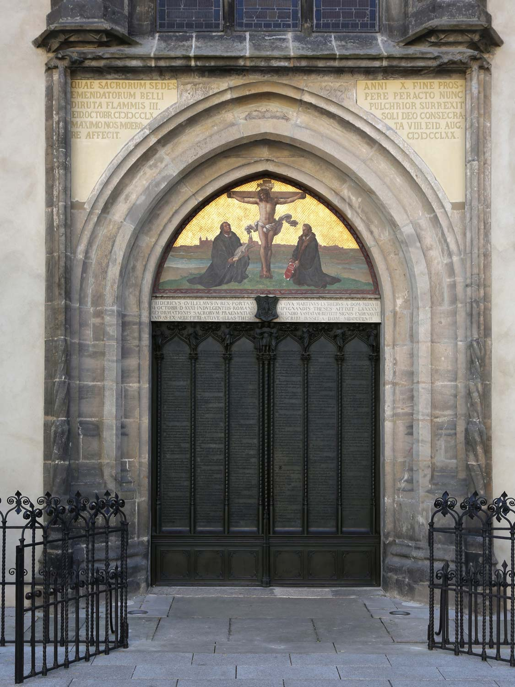
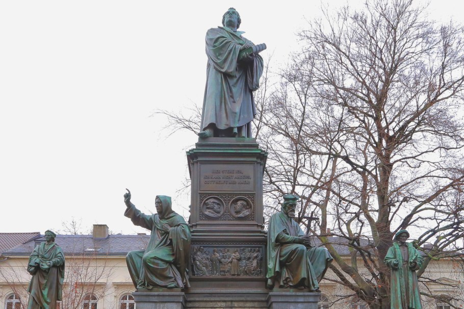
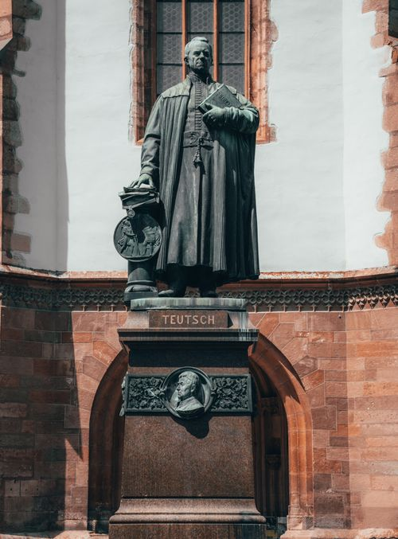
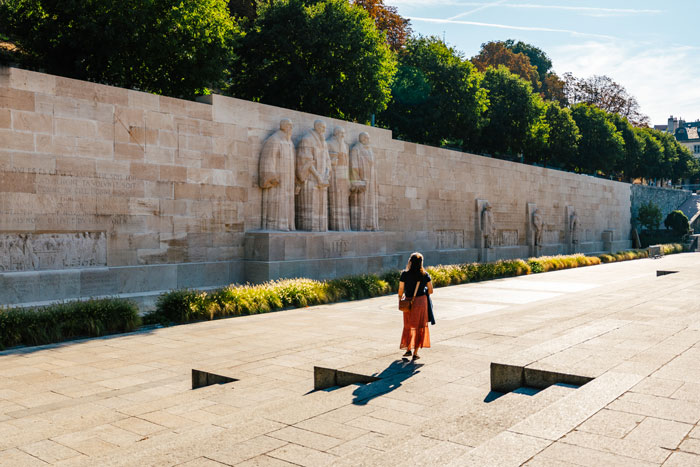

# **РЕФОРМАЦИЯ: ЕВАНГЕЛИЕ, ПИСАНИЕ И СПОРЫ XVI ВЕКА**

[Господь Бог](https://t.me/lordchrist)

*Обложка — художественная реконструкция, а не историческая фотография.*

31 октября 1517 года — дата, с которой часто начинают рассказ о Реформации. В привычном пересказе монах Мартин Лютер прибивает лист с тезисами к церковной двери — и одним жестом начинает протестантизм. История была сложнее. Реформация выросла из споров о вере и церковной жизни, развивалась в немецких и швейцарских землях, привела к возникновению разных протестантских общин и на столетия изменила христианскую Европу.

Реформаторы стремились поставить Писание в центр церковного учения, сделать проповедь и богослужение понятнее людям, распространять Библию на родных языках и развивать школы. Именно в этих переменах протестанты видят важные плоды Реформации. В истории движения рядом с ними стоят расколы, принуждение и нетерпимость к инакомыслящим.

Чтобы понять движение, стоит проследить, как университетский спор вышел за пределы Виттенберга, почему реформаторы расходились между собой и что источники действительно позволяют сказать о знаменитой двери.

## До Лютера: стремление к реформе не началось в 1517 году

В позднем Средневековье верующие и духовенство спорили о церковной власти, проповеди, благочестии, богатстве духовенства и понимании христианской веры. Попытки обновить церковную жизнь предпринимались задолго до Лютера. Уиклиф, Ян Гус и другие критики церковных порядков стали частью этой предыстории, хотя их взгляды и судьбы различались: единого движения, которое лишь ожидало появления Лютера, не было.

В 1517 году Лютер ещё не предлагал создать отдельную церковь; его тезисы были приглашением к богословскому диспуту. Он был монахом-августинцем и преподавал богословие в Виттенбергском университете. Его занимали вопросы о грехе, покаянии, прощении и уверенности человека перед Богом. Поводом для публичного спора стали индульгенции.

Катехизис Католической церкви определяет индульгенцию как освобождение от временного наказания за грех, вина за который уже прощена ([официальное изложение учения](https://www.vatican.va/content/catechism/en/part_two/section_two/chapter_two/article_4/x_indulgences.html)). Индульгенция, согласно этому определению, не отменяет вину за грех и не даёт разрешения грешить. Лютеранское возражение касалось богословского места индульгенций и практики продажи соответствующих грамот.

В лютеранском понимании человек не зарабатывает оправдание добрыми делами. Бог оправдывает его по благодати благодаря Христу, а человек принимает это оправдание верой. Добрые дела следуют за верой, но не служат основанием оправдания. Так позицию выражает Аугсбургское исповедание 1530 года (статьи IV и VI):

> «Люди не могут оправдаться перед Богом собственными силами, заслугами или делами, но оправдываются даром — благодаря Христу, через веру».
> — Аугсбургское исповедание, статья IV

Статья VI называет добрые дела необходимым плодом веры, но не основанием оправдания ([текст исповедания](https://els.org/beliefs/augsburgconfession/)). Это вероисповедная формулировка 1530 года, отражающая более поздний этап спора; её не следует приписывать тезисам Лютера 1517 года.

В письме архиепископу Альбрехту от 31 октября Лютер жаловался на проповеди ([текст письма](https://www.gutenberg.org/cache/epub/31604/pg31604.html)), которые, по его словам, внушали людям опасную уверенность: будто покупка индульгенционной грамоты гарантирует спасение. Это свидетельство самого Лютера о проповедях, которые он слышал; оно не является дословной записью каждого проповедника.

Тезисы показывают, что спор касался не только проповеднической практики. В латинском оригинале тезиса 43 Лютер писал:

> «Христиан следует учить: тот, кто помогает бедному или ссужает нуждающегося, поступает лучше, чем тот, кто покупает индульгенцию».
> — Мартин Лютер, «95 тезисов», тезис 43

В латинском оригинале тезиса 62 он назвал истинным сокровищем Церкви Евангелие:

> «Истинное сокровище Церкви — святейшее Евангелие славы и благодати Божией».
> — Мартин Лютер, «95 тезисов», тезис 62

Однако в тезисе 71 Лютер осудил тех, кто отрицал «апостольские индульгенции». В одном раннем тексте соседствуют критика злоупотреблений и защита того, что Лютер считал истинным учением об индульгенциях. Поэтому точнее сказать, что в 1517 году он ещё не отвергал их целиком: его взгляды продолжали развиваться. Латинский текст тезисов и их цифровое издание доступны на сайте [Оксфордского центра Мартина Лютера](https://editions.mml.ox.ac.uk/editions/luther-95-theses/).

«Диспут о силе и действенности индульгенций» был написан по-латыни и задуман как богословское обсуждение. Само название объявляет диспут и приглашает к спору, в том числе по переписке. Это ещё не программа новой конфессии. Значение тезисов выросло после того, как спор вышел далеко за пределы университета.

## Дверь, письмо и молоток: что говорят источники

Письмо Лютера Альбрехту датировано кануном Дня всех святых — 31 октября 1517 года. Сохранились ранние печатные экземпляры тезисов; [Library of Congress оцифровала нюрнбергский лист 1517 года](https://www.loc.gov/resource/gdcwdl.wdl_07497/). К концу того же года тезисы печатали в нескольких немецких и швейцарских городах. Спор быстро перестал быть только университетским.

Знаменитый эпизод с дверью Замковой церкви подтверждён менее определённо. Источники, рассказывающие о вывешивании тезисов, появились позднее. В хронике 1528 года Кристоф Шейрль упоминает приглашение к диспуту, но не описывает дверь. Георг Рёрер оставил помету в экземпляре Нового Завета, напечатанном в 1540 году; исследователь Мартин Трой предполагает, что запись могла быть сделана около ноября 1544-го. Филипп Меланхтон описал вывешивание в предисловии к сочинениям Лютера в 1546 году, уже после его смерти. Об этом же писал Георг Майор, однако неясно, опирался ли он на собственное воспоминание или на рассказ Меланхтона.

В предисловии 1545 года Лютер вспоминает письма епископам и публикацию тезисов, но не упоминает дверь. Само это молчание не решает вопроса. Университетские правила допускали вывешивание объявлений о диспутах на церковных дверях, поэтому такой эпизод исторически возможен. Вместе с тем современного событию свидетельства очевидца о вывешивании не сохранилось, а знаменитый удар молотком не описан в приведённых источниках.

Историки по-разному оценивают поздние свидетельства: одни считают их достаточными, другие относятся к ним скептически. Вывешивание тезисов возможно, но не подтверждено свидетельством очевидца; знаменитый удар молотком не описан в известных ранних источниках. При этом письмо Лютера, печатное распространение тезисов и последовавший спор подтверждаются независимо от того, где именно были вывешены тезисы. Подробный разбор доводов за и против опубликован Волькером Леппином и Тимоти Венгертом в статье [«Источники за и против вывешивания 95 тезисов»](https://web.archive.org/web/20160326124747/http://www.lutheranquarterly.com/uploads/7/4/0/1/7401289/lq-95theses-leppin_wengert.pdf).

Нынешние бронзовые створки установили в 1858 году. Деревянная дверь, существовавшая при Лютере, погибла в пожаре 1760 года. Таким образом, сегодняшние створки — памятник поздней эпохи, а не дверь 1517 года.

## Из университетского спора — в дело всей империи

После 1517 года спор постепенно затронул не только индульгенции. На первый план вышли вопросы о том, кто вправе толковать Писание, как соотносятся церковная традиция и Библия и где проходит граница между исправлением злоупотреблений и разрывом с прежним порядком.

Печатники распространяли тезисы, брошюры, ответы и полемические тексты. Печатный станок существовал задолго до Лютера, но его использование помогло быстро расширить круг участников спора — от университетских богословов до городских властей и князей. Грамотность при этом оставалась ограниченной: идеи передавались не только через книги, но и через проповеди, чтение вслух, обсуждения и изображения в дешёвых брошюрах. Печатное слово и устная проповедь действовали вместе.

В 1521 году Лютера вызвали на рейхстаг в Вормсе. Его книги осудили, а императорский эдикт запретил распространять и читать его сочинения и объявил его вне закона. Сохранившееся изложение ответа показывает не только отказ отречься, но и то, как Лютер рассуждал о собственных книгах: он разделил их на группы и признал, что в полемике с отдельными противниками бывал чрезмерно резок.

В опубликованном английском переводе ответа Лютер просит опровергнуть его Писанием или убедительным рассуждением и говорит:

> «Моя совесть связана Словом Божьим. Поэтому я не могу и не хочу отречься».
> — Мартин Лютер, ответ на рейхстаге в Вормсе, 1521

Этот текст передаёт исторический источник, но не является дословной стенограммой заседания. В частности, привычная фраза «На том стою и не могу иначе» в приведённом свидетельстве отсутствует. [Опубликованное изложение ответа и документы Вормсского рейхстага](https://germanhistorydocs.org/en/from-the-reformations-to-the-thirty-years-war-1500-1648/luther-and-emperor-charles-v-at-the-diet-of-worms-1521) позволяют увидеть спор сложнее, чем позднейший лозунг.

Памятник в Вормсе открыли в 1868 году. Фигуры у ног Лютера — Вальдо, Уиклиф, Гус и Савонарола — показывают, как позднейшая память поместила его в более долгую историю церковных реформ.

Лютер пережил кризис благодаря защите саксонского курфюрста Фридриха Мудрого. В укрытии в Вартбурге он переводил Новый Завет на немецкий. Его издание вышло в 1522 году, полная Библия в его переводе — в 1534-м. Лютер не был первым переводчиком Библии на немецкий: немецкие переводы и печатные Библии существовали раньше. Влияние его версии объясняется качеством языка, переводческой работой и печатным распространением.

## Книги, школы и грамотность

Реформаторские перемены шли не только через книги. В обращении 1524 года к городским советам Лютер призывал устраивать школы для мальчиков и девочек и собирать библиотеки ([текст обращения](https://editions.mml.ox.ac.uk/editions/ratherren/)). Он связывал эти обязанности с заботой о молодёжи и христианском образовании. В одном месте он сравнивал расходы на оборону с поддержкой школ:

> «Если на борьбу с турками дают один гульден, здесь следовало бы дать сто — пусть даже этих денег хватило бы вырастить только одного настоящего христианина».
> — Мартин Лютер, «К городским советникам всех городов немецкой земли», 1524

Это был призыв к городам, а не описание уже действовавшей системы всеобщего образования. Школы, проповедь на понятном языке и печатные книги расширяли возможности учиться, хотя грамотность и доступ к образованию оставались ограниченными.

О возможном долгосрочном влиянии этих идей исследователи судят, в частности, по данным о грамотности в 452 округах Пруссии в 1871 году — через три с половиной столетия после начала Реформации. В сравнении полностью протестантских и полностью католических округов разница составляла около восьми процентных пунктов. Авторы исследования отдельно пытались учесть исходные различия между регионами. Эти данные относятся к Пруссии XIX века: они не показывают уровень грамотности в Европе XVI столетия и сами по себе не доказывают, что Реформация была единственной причиной различий. Это один из способов изучать возможные отдалённые последствия образовательных призывов ([обзор исследования](https://digitalcommons.chapman.edu/esi_working_papers/178/)).

В 1530 году лютеранские князья и города изложили своё учение в Аугсбургском исповедании. Его главным автором был Филипп Меланхтон. Документ не просто перечислял разногласия: он формулировал, во что верят его подписанты, и предлагал обсудить спорные положения на основании Писания.

Статья IV говорит, что Бог оправдывает человека по благодати и благодаря Христу; человек принимает это оправдание верой, а не заслуживает добрыми делами. Статья VI называет добрые дела необходимым плодом веры, но не основанием оправдания. Исповедание связывает веру и дела, отводя им разное место. Так спор вокруг конкретной практики перерос в оформление лютеранского исповедания, богослужения, общин и образовательных учреждений.

## Цвингли: швейцарская Реформация — не примечание к Лютеру

Пока Лютер спорил в немецких землях, в Цюрихе развивалось собственное реформаторское движение. Ульрих Цвингли, которого также называют Хульдрихом, начал последовательно толковать Евангелие от Матфея в проповедях в 1519 году. Его взгляды складывались в конкретной швейцарской обстановке и в диалоге с более широкими богословскими спорами эпохи; сводить их либо к копированию Лютера, либо к полной изоляции от него было бы неточно.

В 1523 году Цвингли подготовил 67 статей для публичного диспута в Цюрихе ([текст статей](https://oll-resources.s3.us-east-2.amazonaws.com/oll3/store/titles/1682/Zwingli_0763_EBk_v6.0.pdf)). В первых положениях он настаивал, что Евангелие не нуждается в разрешении церковной иерархии, а спасение связано с тем, что совершил Христос. В других статьях он спорил о папской власти, мессе, почитании святых и добрых делах. В предисловии Цвингли заявлял, что готов защищать свои положения на основании Писания и исправить их, если будет показано, что он понял Писание неверно.

Реформация в Цюрихе развивалась постепенно. Городской совет участвовал в решениях о церковной жизни; проповедники, духовенство и жители были частью меняющегося городского сообщества. Цюрихское движение не стало копией Виттенберга: оно сформировало собственную политическую и церковную организацию.

Различия между реформаторами особенно ясно проявились в Марбурге в 1529 году. Ландграф Филипп Гессенский пригласил Лютера, Цвингли и других богословов, надеясь договориться и объединить реформаторские силы. По четырнадцати из пятнадцати пунктов участники смогли выразить значительное согласие. Разногласие сохранилось по вопросу о Вечере Господней: стороны не пришли к единому толкованию слов «Сие есть Тело Моё» и к общему объяснению присутствия Христа в Вечере. [Марбургские статьи](https://ghdi.ghi-dc.org/pdf/eng/Doc.44%20ENG-Marburg%20Articles%20EYG.pdf) зафиксировали и широкое согласие, и оставшийся спор.

Марбургская встреча показывает, что реформаторы могли разделять многие положения и при этом оставаться разными богословскими традициями. Реформация не была единой протестантской партией с одинаковым учением; из разногласий постепенно складывались лютеранские и реформатские направления.

Памятник работы Генриха Наттера открыли в 1885 году. Он показывает, как Цюрих конца XIX века представлял своего реформатора; это не прижизненное изображение Цвингли.

Разногласия были не только богословскими. Реформация развивалась внутри политических союзов и конфликтов Швейцарской конфедерации. В 1531 году Цвингли сопровождал цюрихские войска как капеллан во Второй Каппельской войне и погиб в сражении. Его смерть не завершила швейцарскую Реформацию: движение продолжили другие реформаторы, в том числе Генрих Буллингер.

Вокруг гибели Цвингли возник рассказ о чуде. В позднейшем повествовании Генриха Буллингера говорится, что тело реформатора рассекли и сожгли, а среди пепла будто бы нашли целое сердце. Гибель Цвингли в битве подтверждается независимо; рассказ о сердце передан как часть конфессиональной памяти. Буллингер пересказывает слова другого капеллана, который видел тело после сражения, но не был свидетелем самой гибели. Поэтому рассказ о сердце остаётся преданием, а не установленным фактом ([перевод хроникального рассказа](https://christianhistoryinstitute.org/magazine/article/zwinglis-death-on-battlefield)).

## Женева и другие центры: разные пути Реформации

Реформация не была только лютеранской или цвинглианской. В Женеве перемены шли своим путём. Городские власти прекратили совершение мессы в 1535 году; в 1536-м город принял Реформацию. Вильгельм Фарель проповедовал там и участвовал в укреплении движения. Жан Кальвин приехал в Женеву в июле 1536 года, уже после решения городских властей. Позднее он стал одним из самых влиятельных богословов города, но не был единоличным основателем Женевской Реформации.

Женева стала важным центром реформатской мысли и убежищем для людей, покидавших родные страны из-за веры ([путеводитель Международного музея Реформации](https://musee-reforme.ch/content/2files/in-the-footsteps-of-the-reformation.pdf)). С 1540-х годов сюда приезжали реформаты из Франции, Италии, Англии и Нидерландов — пасторы, преподаватели, юристы, врачи и печатники. Город превратился в узел обмена людьми, текстами и идеями. В 1559 году открылась Академия, где готовили пасторов и учёных; через Женеву и её печатни реформатские идеи распространялись далеко за пределы Швейцарии.

Женева XVI века оставалась городом с собственными законами и религиозными требованиями. Её не следует отождествлять с современным светским пространством, где гарантирована полная свобода вероисповедания. Здесь, как и в других городах, церковные перемены были тесно связаны с городской властью.

Стену Реформации создавали в 1909–1917 годах. В центре — Фарель, Кальвин, Беза и Нокс; на камне также увековечены Лютер, Цвингли и другие участники движения. Стена отражает память о Реформации начала XX века.

На стене есть и имя Мари Дентьер — женщины, писавшей о Реформации и участвовавшей в богословской полемике своего времени. Её присутствие напоминает, что движение не ограничивалось несколькими знаменитыми мужчинами. Как и любой памятник, Стена представляет лишь часть людей и событий эпохи.

## Трудные страницы: реформаторы не были безупречны

Во время Крестьянской войны 1524–1525 годов Лютер сначала признавал справедливость части требований крестьян, обвинял князей в угнетении и призывал решать конфликт по закону, а не силой. В заключении «Наставления к миру» он просил Бога примирить стороны. После перехода восстания к вооружённой борьбе Лютер написал трактат «Против разбойничьих и убийственных шаек крестьян» ([оцифрованный экземпляр издания 1525 года](https://digi.ub.uni-heidelberg.de/diglit/luther1525k); [немецкая транскрипция](https://glaubensstimme.de/doku.php?id=autoren%3Al%3Aluther%3Aw%3Awider_die_raeuberischen_und_moerderischen_rotten)) и призвал правителей к жестокому подавлению:

> «Кто может, пусть бьёт, душит и колет — тайно или открыто».
> — Мартин Лютер, «Против разбойничьих и убийственных шаек крестьян»

Вооружённое восстание — часть исторического контекста, но оно не смягчает жестокости этого призыва.

В 1543 году Лютер опубликовал трактат «О евреях и их лжи» ([текст издания](https://archive.org/details/werkekritischege53luthuoft)). В нём он предлагал преследовать евреев: сжигать синагоги, отбирать имущество, принуждать к труду и изгонять. Это анти-иудейский текст с прямыми призывами к насилию и преследованию. Он документирует взгляды Лютера в 1543 году; сам по себе текст не устанавливает прямой причинной связи с преступлениями XX века, для которой нужны отдельные исторические доказательства.

Ограничения религиозной свободы встречались и в протестантской среде. На рейхстаге в Шпайере в апреле 1529 года князья и города выступили против религиозных постановлений и защищали возможность сохранять евангелическое учение ([текст протеста](https://tueditions.ulb.tu-darmstadt.de/v/pa000008-0123)). С этим протестом связано позднейшее название «протестанты».

В тот же период существовал отдельный императорский мандат против анабаптистов — сторонников крещения по личному исповеданию веры ([текст мандата](https://tueditions.ulb.tu-darmstadt.de/v/pa000008-0111)). Документ от 23 апреля 1529 года предписывал казнить мужчин и женщин, названных в нём «перекрещенцами», в том числе огнём или мечом; раскаявшимся власть могла даровать помилование. Протест князей и городов в Шпайере и императорский мандат — разные документы; мандат не был общим исповеданием всех протестантов. Вместе эти события показывают пределы религиозной свободы в XVI веке: права, которых добивались для собственной общины, не всегда признавались за другими.

Параллельно шли реформы и в католической церкви. Например, в 1563 году Тридентский собор предписал епископам учреждать семинарии для подготовки духовенства ([декрет, сессия XXIII, глава XVIII](https://history.hanover.edu/texts/trent/ct23ref2.html)). Этот процесс не устранил разногласий между церквями, но показывает, что церковная жизнь менялась не только в протестантских землях.

## Распространённые версии и что показывают источники

**«Лютер одним ударом основал протестантизм».** Реформация не началась как готовая конфессия в один день. Тезисы открыли спор, а новые церкви и исповедания складывались постепенно. Название «протестанты» связано с протестом в Шпайере в 1529 году — через двенадцать лет после 31 октября 1517-го.

**«Тезисы точно были прибиты молотком».** Поздние свидетельства допускают вывешивание, но не позволяют восстановить все обстоятельства. Удар молотком в известных ранних источниках не описан; подробнее о разногласиях историков — в разборе, указанном выше.

**«Лютер первым перевёл Библию на немецкий».** Немецкие переводы и печатные Библии существовали до Лютера. Его перевод приобрёл влияние благодаря языку, переводческой работе и печати.

**«Все реформаторы учили одинаково».** Марбургские статьи показывают и широкое согласие Лютера и Цвингли, и их разногласие по Вечере Господней. Реформация породила несколько протестантских традиций.

**«Реформация сразу принесла свободу вероисповедания».** В XVI веке свобода совести в современном смысле не была установлена. Протестанты защищали собственное учение, но анабаптисты и другие группы подвергались преследованию.

**«Католическая церковь не пыталась реформироваться».** Католические реформы шли параллельно протестантским; Тридентский собор, в частности, постановил создавать семинарии для подготовки духовенства.

## Что осталось после споров

Реформация была длительным движением, которое по-разному изменило церковную жизнь в Виттенберге, Цюрихе и Женеве. Оно поставило перед христианскими общинами вопросы о месте Писания, толковании церковного учения, языке проповеди и образовании. Переводы Библии, печать, школы и новые формы церковной жизни стали частью ответа.

Протестантская традиция особенно дорожит стремлением подчинять церковное учение Писанию и проповедью оправдания по благодати через веру во Христа. В наследии Реформации есть и эти богословские и образовательные плоды, и расколы, и принуждение, от которого страдали люди. Полный рассказ сохраняет обе стороны истории.

*Русские переводы цитат из латинских и немецких оригиналов выполнены редакцией; цитаты, взятые из англоязычных публикаций источников, также даны в редакционном переводе.*
