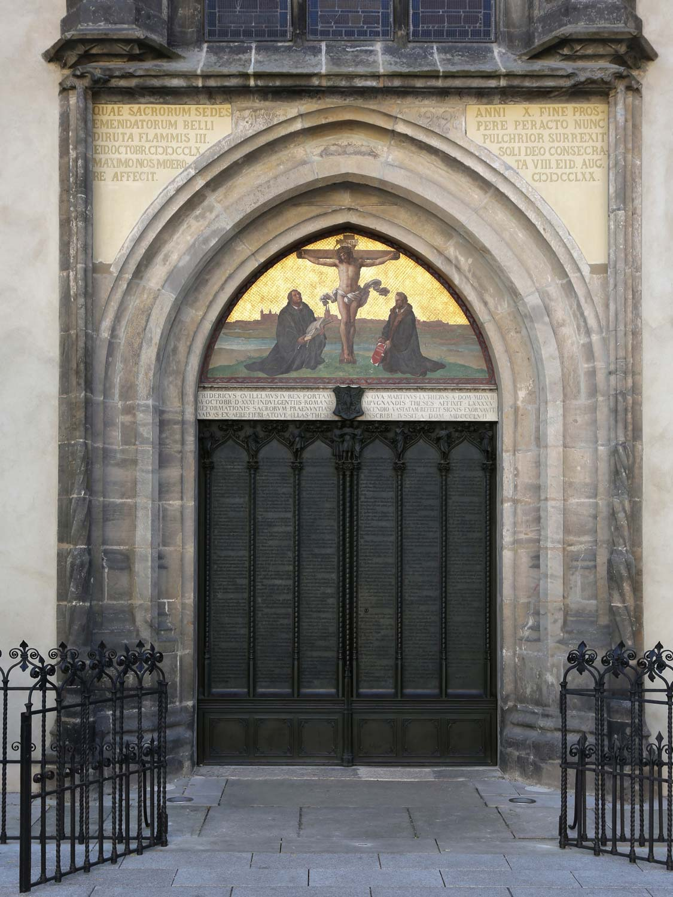
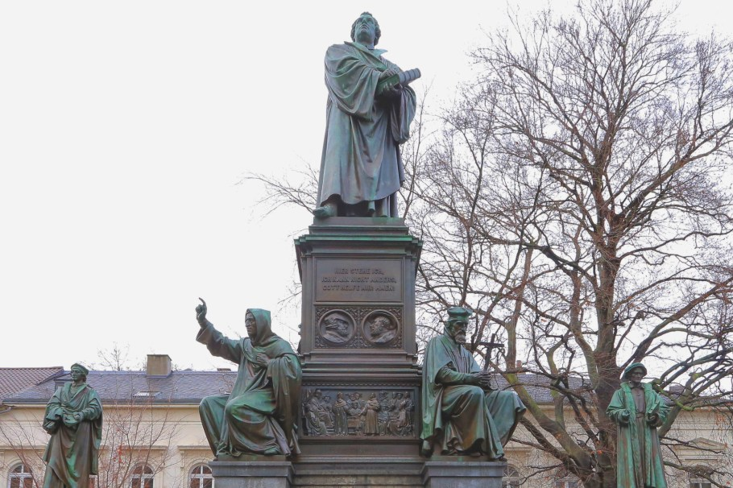
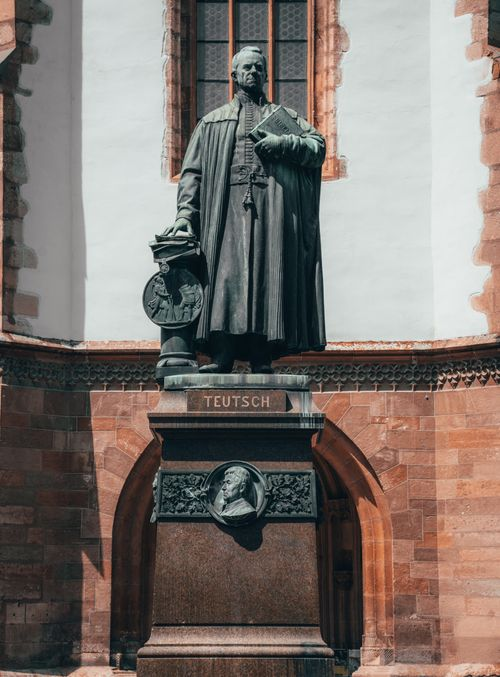
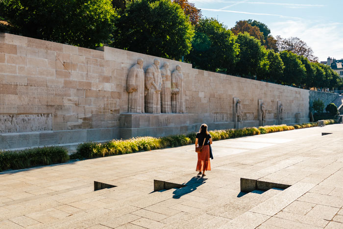

# **РЕФОРМАЦИЯ: ОБНОВЛЕНИЕ ЦЕРКВИ, РАСКОЛЫ И МИФЫ**

<!-- Telegraph masthead cover (separate from the four inline photographs): ../media/lordchrist-reformation-1517-cover.jpg; 2720×1530, 16:9; AI-generated historical reconstruction. -->

31 октября 1517 года — дата, с которой часто начинают рассказ о Реформации. В привычной картине монах Мартин Лютер прибивает лист к двери церкви — и одним жестом рождает протестантизм. История была длиннее и сложнее. Реформация не уместилась в один день и не была делом одного человека: она выросла из споров о вере и церковной жизни, разошлась по немецким и швейцарским городам, породила разные общины и на столетия изменила христианскую Европу.

В этом движении было важное стремление к обновлению: реформаторы хотели вернуть Писанию центральное место, сделать богослужение и учение понятнее людям, распространять Библию на родных языках и открывать школы. Эти перемены дают основания говорить о Реформации как о положительном историческом движении церковного обновления. Но положительная оценка не требует превращать Лютера или других реформаторов в безупречных героев. В их истории есть и призывы к насилию, и нетерпимость к тем, кто верил иначе.

Чтобы понять Реформацию, полезнее проследить не легендарный удар молотка, а то, как университетский спор стал общеевропейским движением — и почему даже его лидеры не смогли договориться между собой.

### До Лютера: стремление к реформе не началось в 1517 году

В позднем Средневековье люди спорили о церковной власти, проповеди, благочестии, богатстве духовенства и том, как верующим понимать христианскую веру. Попытки церковного обновления существовали задолго до Лютера. Уиклиф, Ян Гус и другие критики церковных порядков стали частью предыстории, хотя их взгляды и судьбы были разными и не образовывали единого движения, которое просто ждало появления Лютера.

Сам Лютер не вышел на сцену с готовым планом новой церкви. Он был монахом-августинцем и преподавал богословие в Виттенбергском университете. Его тревожили вопросы о грехе, покаянии, прощении и уверенности человека перед Богом. Поводом для публичного спора стали индульгенции. Катехизис Католической церкви описывает индульгенцию как [снятие временной кары](https://www.vatican.va/content/catechism/en/part_two/section_two/chapter_two/article_4/x_indulgences.html) за грех, вина за который уже прощена. Это точное описание официального католического учения, но оно не исчерпывает протестантского возражения и не оправдывает историческую практику. Мы пишем с протестантской стороны: человек оправдывается перед Богом даром благодати ради Христа, принимаемым верой, а не покупаемым деньгами или заслуживаемым делами. Позднее лютеранское [Аугсбургское исповедание](https://els.org/beliefs/augsburgconfession/) (1530, статьи IV и VI) выразило это ясно: добрые дела следуют за верой, но не служат ценой оправдания. Это зрелая формулировка, её нельзя целиком переносить на тезисы 1517 года.

В письме архиепископу Альбрехту от 31 октября [Лютер жаловался на проповеди](https://www.gutenberg.org/cache/epub/31604/pg31604.html), которые, по его словам, создавали у людей опасную уверенность: будто покупка грамоты гарантирует спасение. Это его свидетельство о проповедях, не стенограмма каждого проповедника. Но спор касался не только дурной подачи: в [тезисе 36](https://editions.mml.ox.ac.uk/editions/luther-95-theses/) Лютер утверждал, что истинно раскаявшийся христианин получает полное отпущение вины и наказания даже без грамоты об индульгенции; в тезисе 43 он ставил помощь бедному выше покупки индульгенции, а в тезисе 62 писал: «Истинное сокровище Церкви — святейшее Евангелие славы и благодати Божией» (редакционный перевод с латыни). При этом тезис 71 осуждал тех, кто отрицал «апостольские индульгенции». Эти напряжения показывают, что в 1517 году Лютер ещё не отверг индульгенции целиком и его богословие продолжало развиваться. Но признание этого не сводит протестантскую критику к недоразумению и не превращает индульгенции в Евангелие.

Его [«Диспут о силе и действенности индульгенций»](https://editions.mml.ox.ac.uk/editions/luther-95-theses/) был написан по-латыни и задуман как богословское обсуждение. В заголовке прямо говорится о диспуте и возможности спорить по переписке. Тезисы — не манифест, объявляющий новую конфессию. Их значение выросло уже после того, как спор вышел далеко за пределы университета.

### Дверь, письмо и молоток: что мы знаем наверняка

Письмо Лютера Альбрехту датировано кануном Дня всех святых, 31 октября 1517 года. Сохранились ранние печатные экземпляры тезисов: [в Library of Congress оцифрован нюрнбергский лист 1517 года](https://www.loc.gov/resource/gdcwdl.wdl_07497/). К концу того же года тезисы уже печатали в нескольких немецких и швейцарских городах. Спор действительно быстро перестал быть только университетским. А вот знаменитая сцена, в которой Лютер собственноручно прибивает лист к двери Замковой церкви, подтверждается куда сложнее.

Источники, рассказывающие о вывешивании, появились позднее. Кристоф Шейрль в хронике 1528 года говорит о приглашении к диспуту, но не описывает дверь. Георг Рёрер оставил помету в экземпляре Нового Завета, напечатанном в 1540 году; исследователь Мартин Трой предполагает, что запись могла появиться около ноября 1544-го. Филипп Меланхтон описал вывешивание в предисловии к сочинениям Лютера после смерти реформатора, в 1546 году. Георг Майор тоже упоминал этот эпизод, но остаётся неясным, опирался ли он на собственную память мальчика-певчего или на рассказ Меланхтона.

В предисловии 1545 года Лютер вспоминает письма епископам и публикацию листа с тезисами, но не рассказывает о двери. Это молчание само по себе не доказывает, что вывешивания не было. Университетские правила предусматривали вывешивание объявлений о диспутах на церковных дверях, поэтому такая сцена вполне могла быть обычным способом пригласить к академическому спору. Но ни помета Рёрера, ни рассказ Меланхтона не описывают знаменитый удар молотком.

Историки по-разному взвешивают эти свидетельства. Одни считают поздние сообщения достаточными, другие относятся к ним скептически; в исследовании источников приводятся доводы за обе стороны, и вопрос не удаётся закрыть окончательно. Осторожная формулировка здесь честнее красивой легенды: вывешивание возможно и поддерживается поздней традицией, но не подтверждено современным событию очевидцем. И как бы ни решился спор о двери, он не отменяет ни сохранившегося письма, ни печатного распространения тезисов, ни последовавших перемен.

*Нынешние бронзовые створки установили в 1858 году. Деревянная дверь времени Лютера погибла в пожаре 1760-го; сегодня перед нами памятник поздней эпохи, а не та самая дверь 1517 года.*

### Из университетского спора — в дело всей империи

После 1517 года спор постепенно стал касаться не только индульгенций. На первый план вышли вопросы о том, кто вправе толковать Писание, как соотносятся церковная традиция и Библия, где проходит граница между исправлением злоупотреблений и разрывом с прежним порядком. Печатники распространяли тезисы, брошюры, ответы и полемику. Печать не создала Реформацию сама по себе — станок существовал задолго до Лютера, — но позволила быстро размножать тексты и вовлекать в спор читателей, городские власти и князей. При этом не следует представлять аудиторию как общество, где каждый мог самостоятельно прочесть трактат: грамотность оставалась ограниченной. Идеи передавались также через проповеди, чтение вслух, обсуждение и изображения в дешёвых брошюрах. Печатная страница и устное слово работали вместе.

В 1521 году Лютера вызвали на рейхстаг в Вормсе. Вопрос был уже не только в богословской дискуссии: его книги осудили, а императорский эдикт запретил распространять и читать его сочинения и объявил Лютера вне закона. На слушании он не просто бросил эффектную фразу, которую позднее повторяли плакаты. В [сохранившемся изложении ответа в Вормсе](https://germanhistorydocs.org/en/from-the-reformations-to-the-thirty-years-war-1500-1648/luther-and-emperor-charles-v-at-the-diet-of-worms-1521) он разделял свои книги на группы и признавал, что в полемике с противниками бывал чрезмерно резок. Он просил опровергнуть его Писанием или убедительным рассуждением и говорил, что не может отречься без такого опровержения. Это изложение не является дословной стенограммой, но оно показывает, что исторический спор был сложнее одного лозунга.

*Памятник в Вормсе открыли в 1868 году. Фигуры у ног Лютера — Вальдо, Уиклиф, Гус и Савонарола — напоминают: позднейшая память вписала его в более длинную историю церковных реформ.*

Лютер пережил этот кризис благодаря защите саксонского курфюрста Фридриха Мудрого. В укрытии в Вартбурге он переводил Новый Завет на немецкий. Издание появилось в 1522 году, полная Библия в его переводе — в 1534-м. Но и здесь важно не упрощать: Лютер не был первым переводчиком Библии на немецкий. Немецкие печатные Библии существовали до него. Его перевод оказался влиятельным благодаря языку, работе переводчика и печатному распространению, а не потому, что до него немецкоязычные христиане никогда не видели Библию.

Изменения шли не только через книги. В [тексте 1524 года](https://editions.mml.ox.ac.uk/editions/ratherren/) Лютер призывал городские советы устраивать школы для мальчиков и девочек и собирать библиотеки. Это было предложение о том, чему городам следует уделить внимание, а не описание уже созданной системы всеобщего образования. Школы, проповедь на понятном языке и печатные книги расширяли возможности обучения, но не означали, что все люди сразу стали грамотными или получили одинаковый доступ к образованию.

Как измерить долгий эффект этих призывов? Экономические историки сравнивали данные по грамотности в 452 округах Пруссии в 1871 году — через три с половиной столетия после начала Реформации. В исходном сравнении полностью протестантских и полностью католических округов разница в грамотности составляла около восьми процентных пунктов; авторы исследования отдельно пытались отделить влияние распространения Реформации от исходных различий между регионами. Это не снимок Европы XVI века и не доказательство, что каждый протестантский край сразу стал всеобщей школой. Это осторожный аргумент о возможном отдалённом последствии, которое изучают по позднейшим данным ([обзор исследования](https://digitalcommons.chapman.edu/esi_working_papers/178/)).

В 1530 году лютеранские князья и города изложили своё учение в [Аугсбургском исповедании](https://els.org/beliefs/augsburgconfession/). Его главным автором был Филипп Меланхтон. Документ объяснял, во что верят его подписанты, и отвечал на обвинения в новизне. В нём вера и добрые дела не противопоставлены как «важно» и «неважно»: исповедание говорит, что человек оправдывается верой, а вера приносит добрые плоды. Так Реформация из спора вокруг конкретной практики превратилась в оформление общин, богослужения, образования и отдельных церковных исповеданий.

### Цвингли: швейцарская Реформация — не примечание к Лютеру

Пока Лютер спорил в немецких землях, в Цюрихе развивалась своя реформационная история. Ульрих Цвингли (его также называют Хульдрихом) начал последовательно толковать Евангелие от Матфея в проповедях в 1519 году. Он пришёл к ряду реформаторских убеждений собственным путём; при этом утверждать, будто он был совершенно изолирован от идей Лютера и других современников, было бы слишком категорично.

В 1523 году Цвингли подготовил [67 статей](https://oll-resources.s3.us-east-2.amazonaws.com/oll3/store/titles/1682/Zwingli_0763_EBk_v6.0.pdf) для публичного диспута в Цюрихе. В первых положениях он настаивал, что Евангелие не нуждается в разрешении церковной иерархии, а спасение связано с тем, что совершил Христос. В других статьях он спорил о папской власти, мессе, почитании святых и добрых делах. В предисловии Цвингли заявлял, что готов защищать свои положения на основании Писания и исправиться, если будет показано, что он понял его неверно, — но тоже на основании Писания.

Важным участником процесса был городской совет: решения о церковных переменах принимались не в отвлечённом богословском пространстве, а в конкретном городе, где власти определяли порядок общественной и религиозной жизни. После диспутов совет стал поддерживать реформу проповеди и церковных порядков. Поэтому речь не о том, что «все цюрихцы однажды решили стать протестантами», а о постепенном изменении городской религиозной жизни при участии проповедников, духовенства, магистратов и жителей. Реформация в Цюрихе стала не копией Виттенберга, а местным движением со своей политической и церковной организацией.

Различия между реформаторами проявились особенно ясно в Марбурге в 1529 году. Ландграф Филипп Гессенский пригласил Лютера, Цвингли и других богословов, надеясь договориться и объединить реформаторские силы. По четырнадцати из пятнадцати пунктов они смогли выразить значительное согласие. Но в последнем, о Вечере Господней, разошлись: стороны не пришли к единому толкованию слов «сие есть Тело Моё» и к одному объяснению присутствия Христа в причастии. Итоговые [Марбургские статьи](https://ghdi.ghi-dc.org/pdf/eng/Doc.44%20ENG-Marburg%20Articles%20EYG.pdf) зафиксировали одновременно и общую почву, и незавершённый спор.

Эта встреча важна не как забавный эпизод о том, кто кому подал руку, а как напоминание: Реформация не была одной протестантской партией с одинаковым учением. Даже люди, которые соглашались в критике многих прежних порядков и ставили Писание в центр, могли серьёзно расходиться в богословии. Позже из этих разногласий выросли разные протестантские традиции.

*Памятник работы Генриха Наттера открыли в 1885 году. Он показывает, как Цюрих конца XIX века представлял своего реформатора; это не изображение самого Цвингли.*

Разногласия были не только богословскими. Реформация развивалась внутри политических союзов и конфликтов Швейцарской конфедерации. В 1531 году Цвингли сопровождал цюрихские войска как капеллан во Второй Каппельской войне и погиб в сражении. Его смерть не завершила швейцарскую Реформацию: движение продолжили другие реформаторы, в том числе Генрих Буллингер. Но она напоминает, что конфессиональный спор уже стал частью вооружённой борьбы за власть и устройство общества.

Вокруг гибели Цвингли возник и собственный рассказ о чуде. В позднейшем повествовании Генриха Буллингера говорится, что тело реформатора после битвы рассекли и сожгли, а среди пепла будто бы нашли целое сердце. Сам факт гибели в битве подтверждается независимо; чудесная деталь о сердце — уже часть конфессиональной памяти, а не проверяемое свидетельство о событии. Буллингер в том же рассказе пересказывает слова другого капеллана, который видел тело после сражения; это не прямое свидетельство о самой смерти. Поэтому историю о сердце важно рассказывать как предание, а не как установленный факт. [Перевод хроникального рассказа](https://christianhistoryinstitute.org/magazine/article/zwinglis-death-on-battlefield) показывает, как эта версия дошла до последующих поколений.

### Женева и другие центры: никакой единой модели

Не вся Реформация была лютеранской или цвинглианской. В Женеве перемены проходили своим путём. Городские власти прекратили совершение мессы в 1535 году; в 1536-м город принял Реформацию. Вильгельм Фарель проповедовал там и участвовал в укреплении нового движения. Жан Кальвин приехал в Женеву в июле 1536 года, уже после городского решения; его влияние стало огромным, но неверно рассказывать историю так, будто именно он в одиночку «основал» Реформацию в городе.

Женева превратилась в важный центр реформатской мысли и убежище для людей, вынужденных покидать родные страны из-за веры; это подробно описывает [путеводитель Международного музея Реформации](https://musee-reforme.ch/content/2files/in-the-footsteps-of-the-reformation.pdf). С 1540-х в город приезжали преследуемые реформаты из Франции, Италии, Англии и Нидерландов; среди них были пасторы, преподаватели, юристы, врачи и печатники. Так религиозное убежище одновременно становилось узлом обмена текстами, людьми и идеями. В 1559 году там открылась Академия, готовившая пасторов и учёных; через город и его печатни реформатские идеи распространялись далеко за пределы Швейцарии. При этом Женева была городом со своими законами и религиозными требованиями, а не современным светским пространством с полной свободой вероисповедания. Как и в других местах, церковные реформы были тесно связаны с городской властью.

*Стена Реформации создавалась в 1909–1917 годах. В центре — Фарель, Кальвин, Беза и Нокс; на камне также увековечены Лютер, Цвингли и другие участники движения. Это памятник XX века, который рассказывает о памяти, а не заменяет историю XVI столетия.*

На Стене есть и имя Мари Дентьер — женщины, писавшей о Реформации и участвовавшей в богословской полемике своего времени. Она напоминает, что движение не состояло только из нескольких знаменитых мужчин. Но и здесь важно не делать из памятника полный перечень: любая монументальная композиция отбирает фигуры и тем самым задаёт собственный рассказ о прошлом.

### Трудные страницы: обновление не сделало реформаторов безупречными

Во время Крестьянской войны 1524–1525 годов Лютер сначала признал справедливость части требований крестьян, обвинял князей в угнетении и призывал решать конфликт по закону, а не силой. В заключении «Наставления к миру» он просил Бога примирить стороны. Но после того как восстание перешло в вооружённую борьбу, Лютер написал «Против разбойничьих и убийственных шаек крестьян» и призвал правителей к жестокому подавлению: «Кто может, пусть крушит, душит и колет — тайно или открыто» (редакционный перевод с немецкого). Насилие повстанцев — часть контекста, но оно не превращает этот призыв в нечто безобидное.

В 1543 году Лютер опубликовал трактат [«О евреях и их лжи»](https://archive.org/details/werkekritischege53luthuoft). В нём он выдвигал преследовательские меры: сжигать синагоги, отбирать имущество, принуждать евреев к труду и изгонять их. Это анти-иудейская ненавистническая полемика, и смягчать её формулировку нельзя. При этом нельзя без отдельного доказательства выстраивать прямую причинную линию от одного трактата к преступлениям XX века. Историческая точность требует одновременно назвать и содержание текста, и границы того, что он доказывает.

Ограничения свободы встречались и среди других реформаторов. На рейхстаге в Шпайере в апреле 1529 года князья и города выступили против религиозных постановлений и защищали возможность сохранять евангелическое учение ([текст протеста](https://tueditions.ulb.tu-darmstadt.de/v/pa000008-0123)). От этого протеста связано позднее название «протестанты». Но в тот же период существовал [отдельный императорский мандат](https://tueditions.ulb.tu-darmstadt.de/v/pa000008-0111) против анабаптистов — сторонников крещения по личному исповеданию веры; в документе их называли повторно крестившимися. Мандат от 23 апреля предписывал казнить мужчин и женщин «зрелого возраста», в том числе огнём или мечом; раскаявшимся власть могла даровать помилование.

Важно не смешивать эти документы: протест князей и городов и мандат против анабаптистов — не одно и то же. Нельзя приписывать каждому участнику протестантского движения подпись под отдельным мандатом. Но само соседство этих событий показывает пределы ранней Реформации: права, которых добивались для собственной общины, не всегда распространялись на другие религиозные группы. Это церковное обновление XVI века, а не современная свобода совести.

И католическая церковь не оставалась неподвижной. Внутренние реформы шли и в католическом мире; Тридентский собор, например, в 1563 году предписал епископам учреждать семинарии для подготовки духовенства ([декрет, сессия XXIII, глава XVIII](https://history.hanover.edu/texts/trent/ct23ref2.html)). Разногласия и конфликты не исчезли, но рассказ о Реформации не должен строиться по схеме «одни менялись, другие никогда».

### Мифы, которые мешают увидеть историю

**«Лютер одним ударом основал протестантизм».** Нет. Тезисы были началом спора, а новые церкви и конфессиональные традиции складывались постепенно. Название «протестанты» связано с протестом в Шпайере в 1529 году — через двенадцать лет после 31 октября 1517-го.

**«Тезисы точно были прибиты молотком».** Письмо и распространение печатных тезисов подтверждены лучше, чем сцена на двери. Поздние свидетельства о вывешивании существуют, но их датировка и вес обсуждаются. В ранних источниках, на которые опирается этот разбор, нет знаменитой детали про молоток.

**«Лютер первым перевёл Библию на немецкий».** Нет: немецкие переводы и печатные Библии существовали до него. Его перевод стал влиятельным и помог изменить язык богословия и литературы, но не возник из пустоты.

**«Все реформаторы думали одинаково».** Нет. Спор Лютера и Цвингли в Марбурге показал, что общее стремление реформировать церковь не устраняло глубоких разногласий.

**«Реформация сразу принесла свободу вероисповедания».** Нет. Протестующие защищали собственные убеждения, но анабаптисты и другие группы могли подвергаться преследованию. Переносить понятие современной свободы религии на XVI век нельзя.

**«Католическая церковь не пыталась реформироваться».** Тоже нет. Католические реформы шли параллельно, пусть и не устраняли расхождений между церквями.

### Что осталось после споров

Реформация была не торжественной церемонией рождения одной новой церкви, а долгим и конфликтным движением. Она заново поставила перед христианскими общинами вопрос о том, как проверять церковные обычаи, кто толкует Писание, на каком языке люди слышат Евангелие и каким должно быть образование. Переводы, печать, школы и новые церковные формы стали частью ответа — разного в Виттенберге, Цюрихе и Женеве.

В этом смысле Реформацию можно считать положительным движением церковного обновления. Но её наследие нельзя свести к победному портрету Лютера на памятнике. Оно включает и реформаторскую надежду, и раскол, и политическое принуждение; и новые школы, и тексты, которые оправдывали насилие; и стремление читать Писание, и отказ признать за другими такую же свободу. Видеть всё это — не значит обесценивать обновление. Это значит относиться к истории всерьёз.
