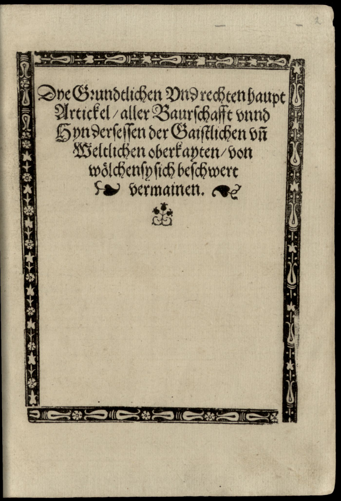
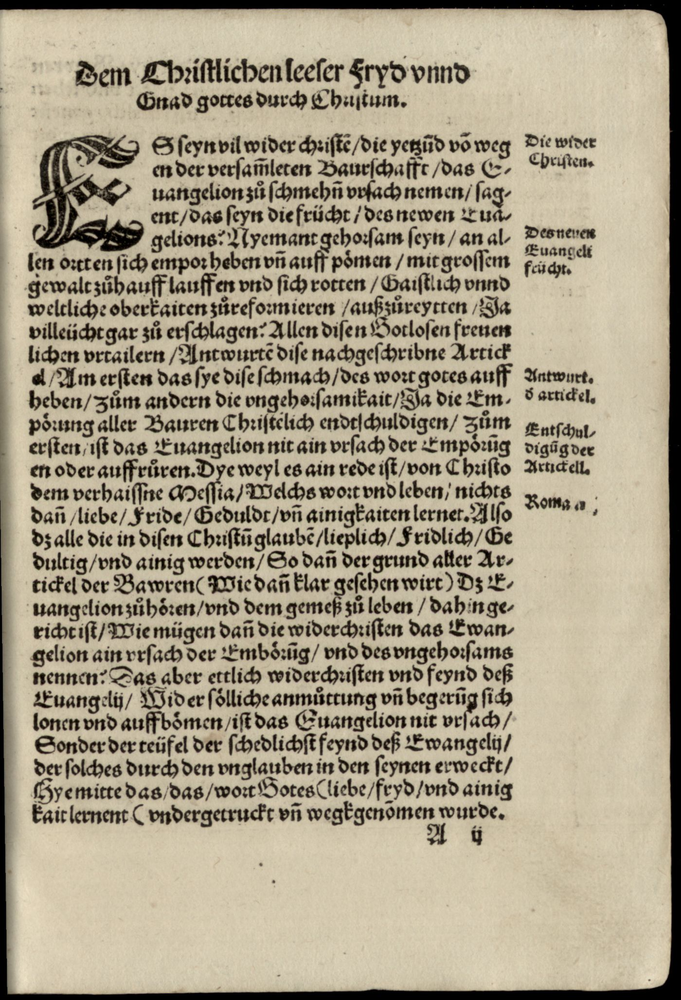
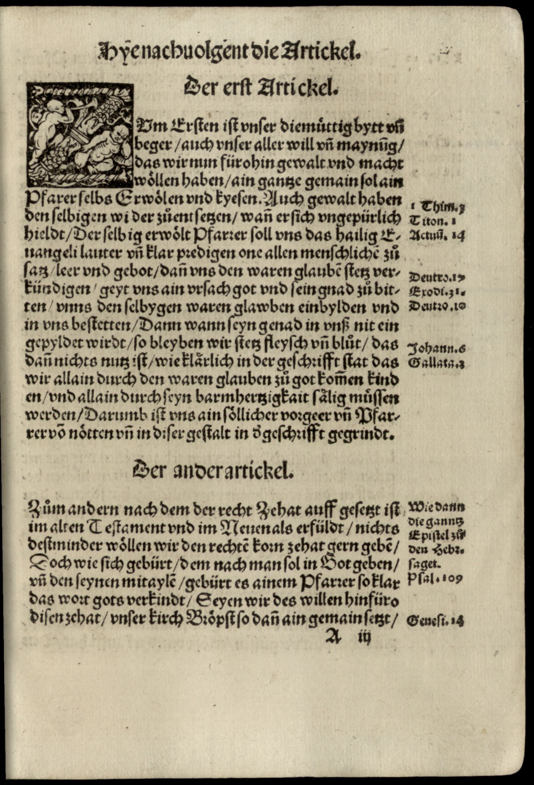
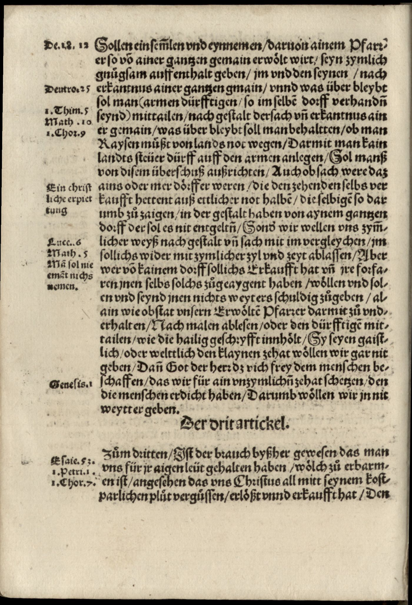
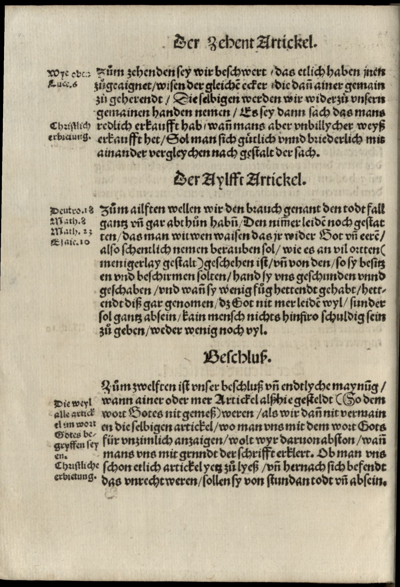
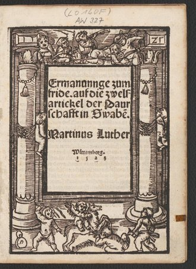

# КРЕСТЬЯНЕ ТРЕБОВАЛИ ПРАВА ВЫБИРАТЬ ПРОПОВЕДНИКА: ГЕРМАНИЯ, 1525 ГОД

Весной 1525 года в немецких землях развернулась Крестьянская война. Но один из самых известных документов этого движения начинается вовсе не с требований о земле или податях. **Первая из «Двенадцати статей» защищала право местной христианской общины выбирать собственного пастора.**

Перед нами не поздний пересказ и не лозунг современного движения. Сохранились подлинные печатные экземпляры 1525 года — с их старой орфографией, типографскими украшениями и последовательностью всех двенадцати требований. По одному такому экземпляру мы можем проследить, как Евангелие, жизнь прихода и социальные конфликты столкнулись в одном историческом событии.

## Мемминген: как возникли «Двенадцать статей»

Мемминген был имперским городом со своими властями, цехами, госпиталем и обширными хозяйственными связями с окрестными деревнями. Недовольство крестьян касалось повинностей, судебных платежей, использования лесов и положения зависимых семей. Вместе с этим всё чаще возникал вопрос, кто вправе определять содержание церковной проповеди.

24 февраля 1525 года представители зависимых от города деревень изложили жалобы Меммингенскому совету. Для этой местной ситуации был составлен **отдельный документ из десяти статей**. Не следует смешивать его с более известными региональными «Двенадцатью статьями».

Примерно между **28 февраля и 3 марта** Себастьян Лотцер, меммингенский горожанин и писарь Бальтрингенского крестьянского отряда, обобщил требования верхнешвабских союзов в двенадцати пунктах. Проповедник Кристоф Шаппелер был важным участником местной реформационной среды; приписывать ему без оговорок авторство каждой строки документа нельзя.

В аугсбургской печати Мельхиора Раммингера текст открывается обращением к христианскому читателю. Составители защищаются от обвинения в мятеже, объясняя, что хотят обосновать свои требования Божьим Словом. Религиозный язык здесь не был декоративным предисловием к экономическому списку: он задавал критерий, по которому предлагалось судить о требованиях.

## Первая статья: кто должен выбирать пастора?

**Община хотела самостоятельно избирать и, при необходимости, отстранять пастора.** От служителя ожидали ясного провозглашения Евангелия, без человеческих добавлений к учению. Это был чрезвычайно конкретный вопрос церковной жизни.

В приходской системе того времени назначение духовенства могло зависеть от прав покровителя, землевладельца и церковной иерархии. Поэтому требование общинного избрания означало изменение реального распределения власти. Кто назначает пастора — тот во многом влияет и на то, чья проповедь звучит в церкви.

Первая статья не была программой современного религиозного плюрализма. Крестьяне говорили о том, каким должен быть христианский приход в их понимании, и ссылались на Писание как на высшее мерило церковного устройства.

## Третья статья: искупление Христом и личная зависимость

Следом шли требования, связанные с хозяйством. Вторая статья предлагала изменить распределение десятины: средства должны были служить содержанию пастора и помощи нуждающимся. Это не было простым лозунгом «отменить все церковные платежи».

**Третья статья** отвергала положение, при котором крестьяне считались личной собственностью других людей. Авторы апеллировали к тому, что Христос искупил людей Своей драгоценной кровью, не делая различия между крестьянином и господином. При этом они особо поясняли, что **не выступают за жизнь без всякой власти**.

Здесь обнаруживается напряжение, которое определяло 1525 год: богословские положения о человеке и искуплении стали применять к конкретным социальным отношениям. Но из самой статьи нельзя вывести ни отмену всех общественных обязанностей, ни единую политическую программу всех восставших.

## Охота, леса, повинности и последняя статья

Четвёртая и пятая статьи касались охоты, рыбной ловли и доступа к лесам. Шестая–восьмая — барщины и справедливости повинностей. Далее обсуждались судебные взыскания, общинные земли и тягостные выплаты после смерти зависимого крестьянина.

Однако конец документа не просто подводит итог. **Двенадцатая статья допускает отказ от любого требования, если на основании Священного Писания будет доказано, что оно неправомерно.** Авторы предъявляли читателю не только перечень претензий, но и собственное заявленное правило их проверки.

## Как местные жалобы стали печатным событием

«Двенадцать статей» быстро распространились за пределы Меммингена. Городской архив насчитывает **25 изданий в 15 местах печати**; такая типографская скорость помогла превратить региональные требования в общеимперскую тему. Это не означает, что каждый восставший отряд подчинялся единому штабу или принимал все пункты одинаково.

7 марта представители верхнешвабских крестьянских объединений приняли отдельную **«Союзную организацию Христианского объединения»**. Продолжались переговоры с властями, но усиливалось и вооружённое противостояние. Некоторые местные жалобы рассматривались городскими советами; часть договорённостей осталась на бумаге.

Историю этого этапа лучше понимать по документам — статьям, письмам и соглашениям, — а не только по изображениям битв.

## Два разных ответа Лютера

Весной 1525 года Мартин Лютер выпустил *«Увещание к миру по поводу двенадцати статей швабского крестьянства»*. В нём он обличал злоупотребления господ и признавал серьёзность ряда жалоб, но одновременно отказывал крестьянам в праве оправдывать вооружённый мятеж Евангелием. Сочинение было обращено **к обеим сторонам конфликта**, а не служило одобрением восстания.

В апреле кризис обострился. Под Вайнсбергом восставшие убили нескольких пленённых представителей знати. Почти одновременно, **17 апреля**, в другой части Швабии заключили Вайнгартенское соглашение, показывавшее, что переговоры ещё оставались возможны. Эти события не были действиями одной и той же группы.

Затем Лютер опубликовал *«Против разбойных и убийственных шаек крестьян»*. Теперь он не ограничивался призывом к порядку: сочинение прямо призывало правителей применять смертельную силу к мятежникам. Это подтверждается ранними немецкими печатными текстами 1525 года, которые доступны в [цифровом издании Оксфордской библиотеки](https://editions.mml.ox.ac.uk/editions/peasants-nuremberg/).

Оба произведения принадлежат Лютеру, но возникли на разных этапах весеннего кризиса. Преступления вооружённых отрядов нельзя скрывать за благородными требованиями их предшественников; столь же важно не скрывать и суровость рекомендаций реформатора. За ними стоял острый спор о законной власти, христианской свободе и пределах применения силы.

## Что сохранила история

Первая статья документа 1525 года показывает, что вопрос об избрании пастора был для участников движения не второстепенной деталью. Он стоял **в начале** программы, где религиозные и социальные требования образовывали единое целое.

Это не делает Крестьянскую войну мирной кампанией за свободу вероисповедания, а самих крестьян — единодушным движением. История включала и попытки мирных решений, и жестокость вооружённой борьбы. Но её нельзя свести к представлению о толпе, у которой будто бы не было ясно сформулированных требований.

**Перед нами реальный печатный документ, и его первый пункт говорит о праве христианской общины выбирать того, кто будет проповедовать ей Евангелие.**

## Первичные документы и проверяемые материалы

[Аугсбургское издание «Двенадцати статей» 1525 года — Bayerische Staatsbibliothek (bsb00025768)](https://www.digitale-sammlungen.de/de/view/bsb00025768?page=,1).

[Городской архив Меммингена: подлинные экземпляры и сведения об изданиях](https://stadtarchiv.memmingen.de/quellen/reformation-und-bauernaufstand/zwoelf-artikel-der-bauernschaft-augsburger-erstdruck.html).

[Мемминген: хронология восстания, десять и двенадцать статей, союзный устав](https://stadtarchiv.memmingen.de/publikationen/memmingen-und-das-aufbegehren-von-bauern-und-buergern-1525.html).

[Мартин Лютер, «Увещание к миру» — оригинальная печать 1525 года](https://www.e-rara.ch/zuz/content/titleinfo/215807).

[Мартин Лютер, памфлет против восставших — ранний немецкий текст, Oxford Taylor Editions](https://editions.mml.ox.ac.uk/editions/peasants-nuremberg/).

[Исследовательская глава Research: проверка контекста и источников](https://github.com/FedorMilovanov/Research/blob/main/docs/research/reformation/episode07_luther_peasants_war_1524_1525_manuscript.md).

*Подписи к изображениям: Bayerische Staatsbibliothek München (Public Domain Mark 1.0); Zentralbibliothek Zürich / e-rara. Изображения — подлинные сканы исторических печатных экземпляров, без искусственных реконструкций.*
