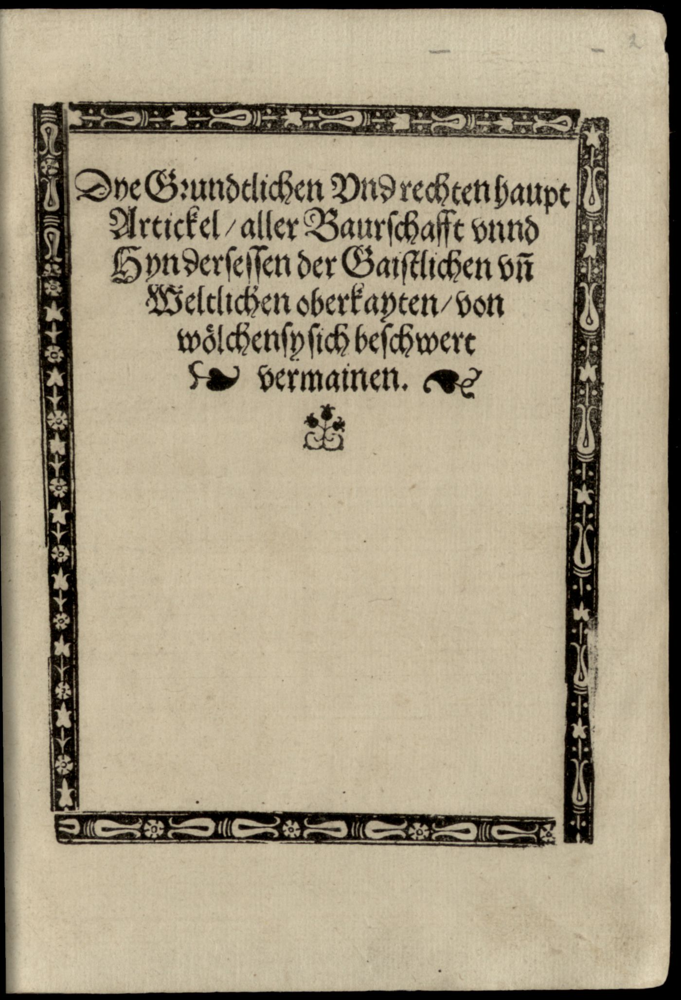
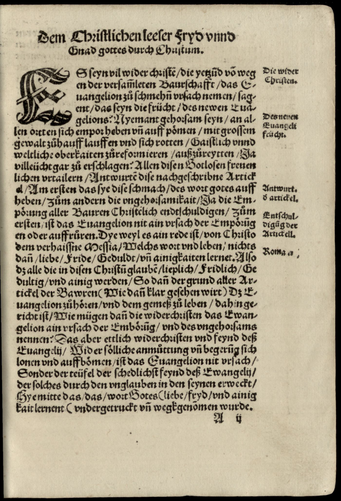
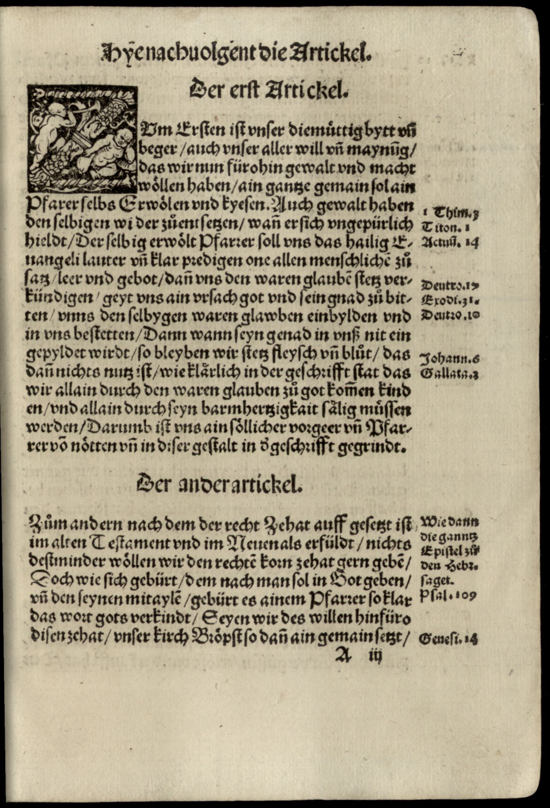
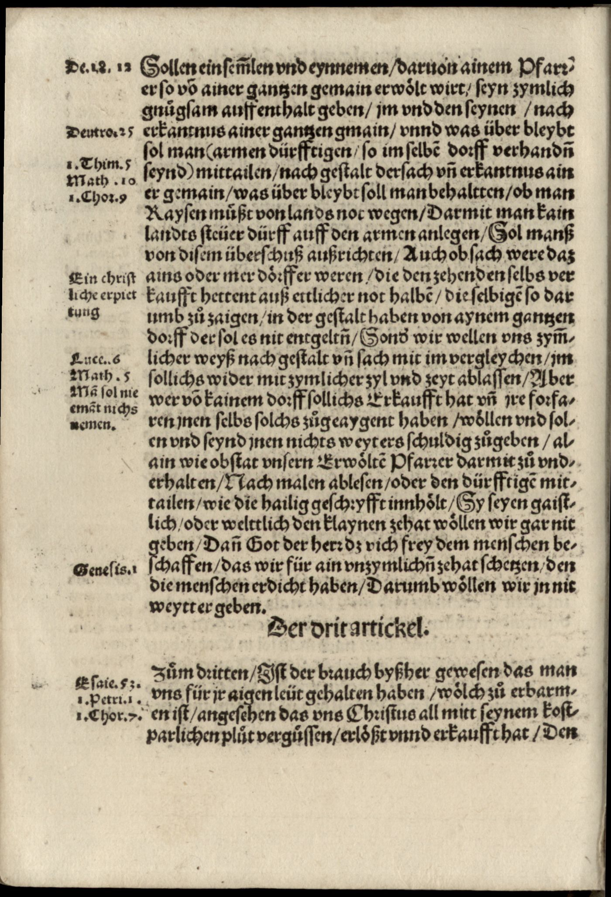
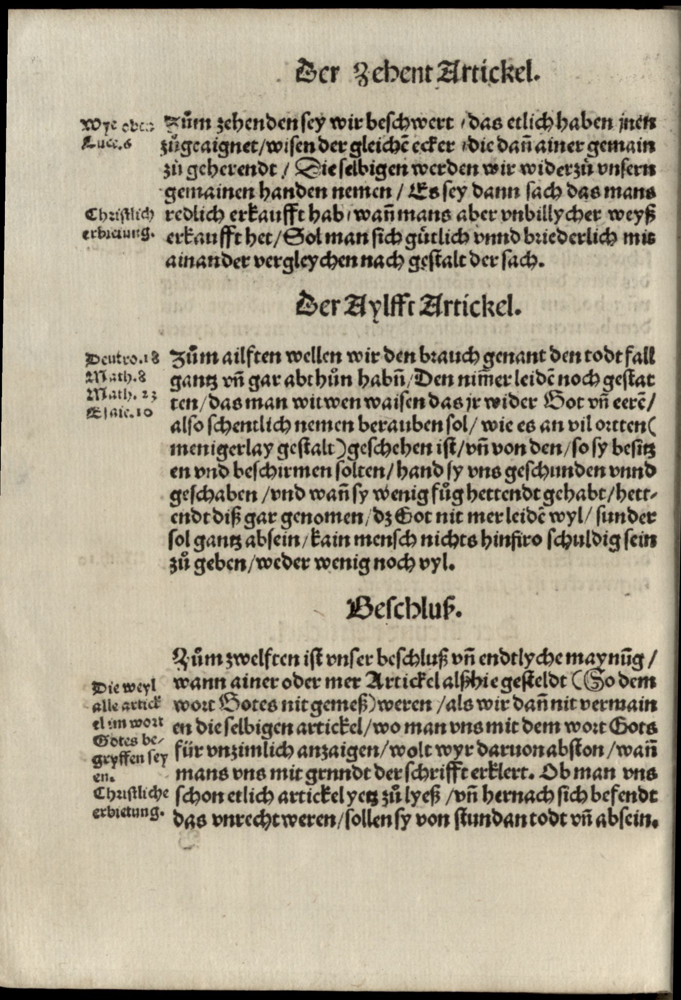
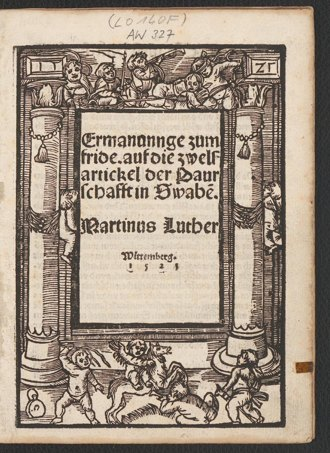

# НЕМЕЦКИЕ КРЕСТЬЯНЕ ПОТРЕБОВАЛИ ПРАВА ВЫБИРАТЬ ПРОПОВЕДНИКА: ШВАБИЯ, 1525 ГОД

Весной 1525 года крестьяне из [Швабии](https://telegra.ph/1525-pochemu-nemeckie-krestyane-trebovali-prava-vybirat-propovednika-11-15#Швабия), исторической области на юге земель **современной Германии**, составили [«Двенадцать статей»](https://telegra.ph/1525-pochemu-nemeckie-krestyane-trebovali-prava-vybirat-propovednika-11-15#Двенадцать-статей): **документ из двенадцати требований к властям и землевладельцам**, а не газетные публикации. Тогда единого государства Германия ещё не существовало: речь идёт о землях Священной Римской империи, в Центральной Европе. Это **не история России**.

Первое требование касалось права местной христианской общины самостоятельно выбирать пастора — служителя, который проповедует Евангелие. Земля, налоги и обязательные работы тоже упоминались, но шли в следующих пунктах.

Сохранились **подлинные печатные экземпляры 1525 года** — с оригинальной немецкой орфографией, украшениями типографии и всеми двенадцатью пунктами. В этой статье приведены настоящие архивные страницы. Непривычные названия можно нажать: ссылки ведут к коротким определениям в [словаре в конце статьи](https://telegra.ph/1525-pochemu-nemeckie-krestyane-trebovali-prava-vybirat-propovednika-11-15#Словарь-эпохи).

## Мемминген: город, в котором составили документ

[Мемминген](https://telegra.ph/1525-pochemu-nemeckie-krestyane-trebovali-prava-vybirat-propovednika-11-15#Мемминген) — город на юге современной Германии, сегодня в Баварии. В 1525 году он был **имперским городом**: имел собственный городской совет и особое положение в Священной Римской империи. Недовольство жителей окрестных деревень касалось [повинностей](https://telegra.ph/1525-pochemu-nemeckie-krestyane-trebovali-prava-vybirat-propovednika-11-15#Повинности) — обязательных работ и платежей в пользу господ, — судебных штрафов, использования лесов и положения зависимых семей. Одновременно возникал вопрос, кто назначает проповедника в местной церкви.

24 февраля 1525 года представители деревень, связанных с Меммингеном, изложили жалобы городскому совету. Они составили **собственный местный перечень из десяти пунктов**. Это не тот же самый документ, что более известные региональные «Двенадцать статей» швабских крестьян.

Примерно между **28 февраля и 3 марта** Себастьян Лотцер, житель Меммингена и писарь [Бальтрингенского крестьянского отряда](https://telegra.ph/1525-pochemu-nemeckie-krestyane-trebovali-prava-vybirat-propovednika-11-15#Бальтрингенский-отряд), объединил требования нескольких швабских крестьянских общин в двенадцать пунктов. Название отряда происходит от деревни Бальтринген в нынешней Германии. Проповедник Кристоф Шаппелер участвовал в местной Реформации, но утверждать, будто он написал каждую строку документа, оснований нет.

Документ напечатали, в частности, в **Аугсбурге** — ещё одном городе на территории современной Германии, — в типографии Мельхиора Раммингера. Во вступлении авторы объясняли читателям, что хотят проверять свои требования по Священному Писанию. Они защищались от обвинения в мятеже. Ссылки на Евангелие были не украшением текста, а частью аргументации.

## Первая статья: кто должен выбирать пастора?

Стремление первой статьи можно передать так: **«Мы желаем иметь право и власть, чтобы вся община сама избирала и выбирала пастора».** Это редакционный русский перевод соответствующего положения оригинального немецкого текста; современные слова не подменяют старую печать.

**Община хотела самостоятельно избирать и, при необходимости, отстранять пастора.** От служителя ожидали ясного провозглашения Евангелия, без человеческих добавлений к учению. Это был чрезвычайно конкретный вопрос церковной жизни.

Тогда пастора местного [прихода](https://telegra.ph/1525-pochemu-nemeckie-krestyane-trebovali-prava-vybirat-propovednika-11-15#Приход) — церковной общины определённой местности — нередко назначали с участием церковных властей или землевладельца, обладавшего правом покровительства. Требование крестьян меняло порядок принятия решения: выбирать служителя должны были сами верующие общины.

Это не было требованием современной свободы выбирать любую религию: авторы обсуждали устройство христианского прихода и ссылались на Писание как на высшее мерило церковного учения.

## Третья статья: искупление Христом и личная зависимость

Следующие пункты касались хозяйства. **Вторая статья** предлагала иначе распределять [десятину](https://telegra.ph/1525-pochemu-nemeckie-krestyane-trebovali-prava-vybirat-propovednika-11-15#Десятина) — сбор с сельскохозяйственных продуктов, исторически связанный с десятой частью урожая. Часть средств должна была идти на содержание пастора и помощь нуждающимся. Это не было требованием отменить вообще все церковные платежи.

**Третья статья** требовала упразднить [личную зависимость](https://telegra.ph/1525-pochemu-nemeckie-krestyane-trebovali-prava-vybirat-propovednika-11-15#Личная-зависимость) крестьян от господ — правовые ограничения их свободы, связанные с властью землевладельца. Авторы ссылались на искупление людей Христом независимо от их общественного положения, но **не требовали упразднить всякую гражданскую власть**. Условия зависимости в землях XVI века нельзя полностью отождествлять с российским крепостным правом более поздних столетий.

Здесь видно, как богословский довод об искуплении применялся к общественным отношениям. Но документ не был общей политической программой каждого отряда, участвовавшего в Крестьянской войне.

## Охота, леса, повинности и последняя статья

Четвёртая и пятая статьи касались охоты, рыболовства и пользования лесами. Шестая–восьмая — [барщины](https://telegra.ph/1525-pochemu-nemeckie-krestyane-trebovali-prava-vybirat-propovednika-11-15#Барщина), то есть обязательной работы на землевладельца, и других повинностей. Затем речь шла о судебных взысканиях, общинных землях и выплатах наследников после смерти зависимого крестьянина.

Однако конец документа не просто подводит итог. **Двенадцатая статья допускает отказ от любого требования, если на основании Священного Писания будет доказано, что оно неправомерно.** Авторы предъявляли читателю не только перечень претензий, но и собственное заявленное правило их проверки.

## Как местные жалобы стали печатным событием

«Двенадцать статей» быстро распространились за пределы Меммингена. Городской архив насчитывает **25 изданий в 15 местах печати**; такая типографская скорость помогла превратить региональные требования в общеимперскую тему. Это не означает, что каждый восставший отряд подчинялся единому штабу или принимал все пункты одинаково.

7 марта представители нескольких швабских крестьянских союзов приняли отдельный устав [«Христианского объединения»](https://telegra.ph/1525-pochemu-nemeckie-krestyane-trebovali-prava-vybirat-propovednika-11-15#Христианское-объединение): объединения для совместных переговоров и действий, а не название отдельной церкви. Переговоры с властями продолжались, но усиливалось и вооружённое противостояние. Некоторые местные жалобы рассматривали городские советы, и не каждое обещанное решение было исполнено.

Историю этого этапа лучше понимать по документам — статьям, письмам и соглашениям, — а не только по изображениям битв.

## Два разных ответа Лютера

Весной 1525 года Мартин Лютер выпустил *«Увещание к миру по поводу двенадцати статей швабского крестьянства»*. В нём он обличал злоупотребления господ и признавал серьёзность ряда жалоб, но одновременно отказывал крестьянам в праве оправдывать вооружённый мятеж Евангелием. Сочинение было обращено **к обеим сторонам конфликта**, а не служило одобрением восстания.

В апреле под **Вайнсбергом** (город в современной Германии) восставшие убили нескольких пленённых представителей знати. Но **17 апреля** в другом месте, близ Вайнгартена, крестьянские представители и противостоявшие им силы заключили соглашение, показывавшее, что переговоры ещё оставались возможны. Эти события происходили в разных местах и не были действиями одной группы.

Затем Лютер опубликовал *«Против разбойных и убийственных шаек крестьян»*. Теперь он не ограничивался призывом к порядку: сочинение прямо призывало правителей применять смертельную силу к мятежникам. Это подтверждается ранними немецкими печатными текстами 1525 года, которые доступны в [цифровом издании Оксфордской библиотеки](https://editions.mml.ox.ac.uk/editions/peasants-nuremberg/).

Оба произведения принадлежат Лютеру, но возникли на разных этапах весеннего кризиса. Преступления вооружённых отрядов нельзя скрывать за благородными требованиями их предшественников; столь же важно не скрывать и суровость рекомендаций реформатора. За ними стоял острый спор о законной власти, христианской свободе и пределах применения силы.

## Что сохранила история

Первая статья документа 1525 года показывает, что вопрос об избрании пастора был для участников движения не второстепенной деталью. Он стоял **в начале** программы, где религиозные и социальные требования образовывали единое целое.

Это не делает Крестьянскую войну мирной кампанией за свободу вероисповедания, а самих крестьян — единодушным движением. История включала и попытки мирных решений, и жестокость вооружённой борьбы. Но её нельзя свести к представлению о толпе, у которой будто бы не было ясно сформулированных требований.

**Перед нами реальный печатный документ, и его первый пункт говорит о праве христианской общины выбирать того, кто будет проповедовать ей Евангелие.**

## Словарь эпохи

Нажатие на выделенный термин в статье ведёт к его определению здесь. Географические названия относятся к немецким землям Центральной Европы XVI века, **не к России**.

## Швабия

Историческая область на юго-западе немецкоязычных земель Центральной Европы. В XVI веке её территории входили в состав **Священной Римской империи** — политического объединения множества княжеств, городов и других владений. Сегодня это главным образом земли юга современной Германии; отдельные районы исторической Швабии лежат и за её нынешними границами.

## Двенадцать статей

Не статьи в газете и не двенадцать законов, уже принятых властями, а **документ из двенадцати сформулированных требований** верхнешвабских крестьян к церковным и светским господам в 1525 году. «Статья» здесь значит *пункт документа*. Текст быстро распространили печатным способом.

## Мемминген

Город на юге нынешней Германии, в Баварии. В 1525 году — **вольный имперский город** Священной Римской империи с городским советом. Здесь в начале марта составили известный свод требований; рядом существовал отдельный местный перечень из десяти пунктов.

## Повинности

Обязательные платежи, поставки продуктов или работы, которые крестьянин должен был исполнять в пользу землевладельца или другой власти. Их виды и размеры отличались от одного владения к другому.

## Бальтрингенский отряд

Один из крестьянских союзов восстания 1525 года. Название происходит от деревни **Бальтринген** (ныне Баден-Вюртемберг, Германия). Это не название отдельного народа и не воинская часть современного государства.

## Приход

Христианская церковная община определённой местности, где служил пастор или священник. Назначение служителя в XVI веке нередко зависело от церковных властей и прав покровителя; крестьяне требовали передать выбор самой общине.

## Десятина

Исторический церковный сбор с сельскохозяйственной продукции. Название связано с долей около одной десятой, но реальные правила взимания и получатели различались. Вторая статья предлагала пересмотреть, кому достаются эти средства и на что они расходуются.

## Личная зависимость

Правовое положение крестьянина, связанного властью господина и рядом ограничений личной свободы и распоряжения имуществом. Оно имело различные формы в германских землях. **Не следует механически переносить на него все особенности крепостного права Российской империи.**

## Барщина

Обязательная работа крестьянина на земле или в хозяйстве господина. Не всякая повинность была барщиной: существовали также денежные и натуральные платежи.

## Христианское объединение

Союз нескольких швабских крестьянских объединений, чья совместная организация была оформлена в марте 1525 года. Название выражало религиозный язык движения; **это не церковная конфессия** и не объединение всех крестьян германских земель.

## Первичные документы и проверяемые материалы

[Аугсбургское издание «Двенадцати статей» 1525 года — Bayerische Staatsbibliothek (bsb00025768)](https://www.digitale-sammlungen.de/de/view/bsb00025768?page=,1).

[Городской архив Меммингена: подлинные экземпляры и сведения об изданиях](https://stadtarchiv.memmingen.de/quellen/reformation-und-bauernaufstand/zwoelf-artikel-der-bauernschaft-augsburger-erstdruck.html).

[Мемминген: хронология восстания, десять и двенадцать статей, союзный устав](https://stadtarchiv.memmingen.de/publikationen/memmingen-und-das-aufbegehren-von-bauern-und-buergern-1525.html).

[Мартин Лютер, «Увещание к миру» — оригинальная печать 1525 года](https://www.e-rara.ch/zuz/content/titleinfo/215807).

[Мартин Лютер, памфлет против восставших — ранний немецкий текст, Oxford Taylor Editions](https://editions.mml.ox.ac.uk/editions/peasants-nuremberg/).

[Исследовательская глава Research: проверка контекста и источников](https://github.com/FedorMilovanov/Research/blob/main/docs/research/reformation/episode07_luther_peasants_war_1524_1525_manuscript.md).

*Подписи к изображениям: Bayerische Staatsbibliothek München (Public Domain Mark 1.0); Zentralbibliothek Zürich / e-rara. Изображения — подлинные сканы исторических печатных экземпляров, без искусственных реконструкций.*
